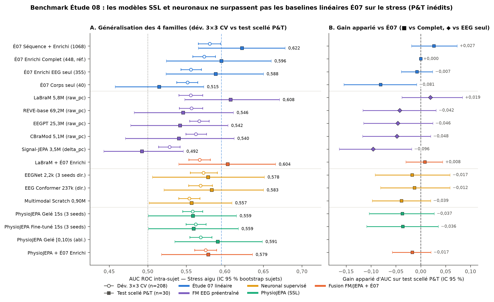
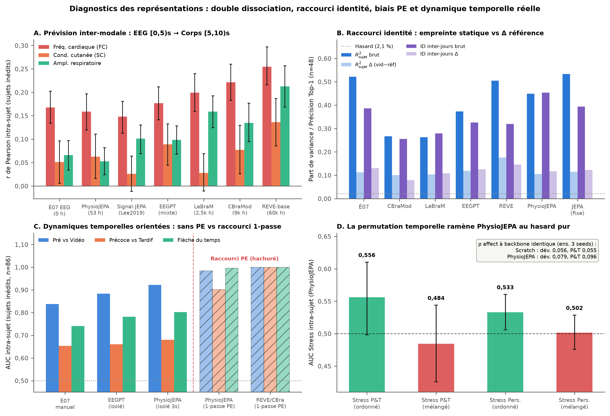
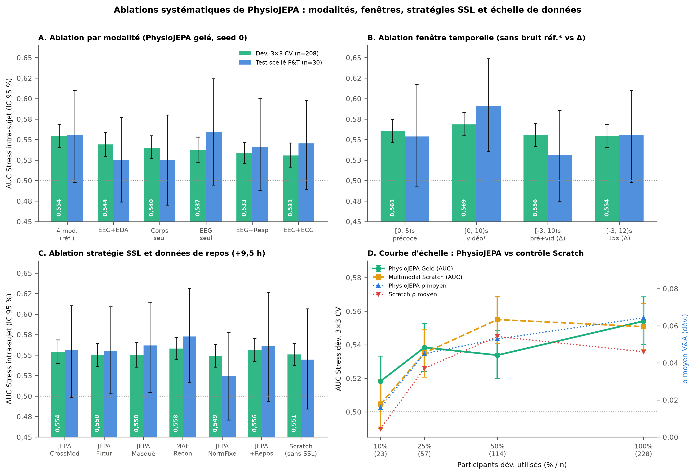
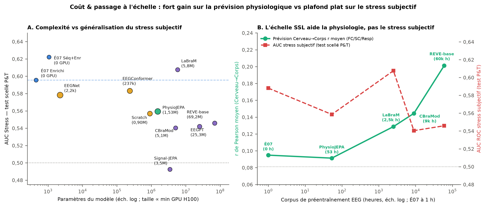

# Étude 08 : apprentissage auto-supervisé (SSL) et modèle du monde physiologique multimodal (`PhysioJEPA`) — représentations transférables ou surcoût sans gain ?

[Protocole pré-enregistré et provenance](../../../journal/08_ssl_multimodal_jepa.md) ·
[agrégats JSON](results) · [figures EN/FR](figures) ·
[générateur de figures](make_figures.py)

---

## Verdict exécutif

> **Question centrale :** L'apprentissage auto-supervisé — via des modèles de fondation EEG préentraînés (`Signal-JEPA`, `CBraMod`, `LaBraM`, `EEGPT`, `REVE-base`) et via un modèle du monde physiologique multimodal natif HABS (`PhysioJEPA` sur EEG + ECG + EDA + respiration) — permet-il d'apprendre des représentations latentes neurophysiologiques qui se transfèrent mieux entre individus et stimuli inédits que les baselines linéaires enrichies de l'Étude 07 ?
>
> **Réponse empirique — une double dissociation nette :**
> 1. **OUI pour la dynamique neurophysiologique objective (prévision cerveau→corps et ordre temporel).** Le préentraînement EEG à grande échelle suit une loi d'échelle monotone sur la prévision inter-modale (`EEG [0, 5) s → Corps [5, 10) s` chez des sujets strictement inédits, $n = 86$) : `REVE-base` (69,2 M, >60 000 h) surpasse massivement les caractéristiques spectrales manuelles de l'Étude 07 sur la fréquence cardiaque ($r = +0{,}255$ vs $+0{,}168$, **+52 %**, IC 95 % disjoints), la conductance cutanée ($+0{,}136$ vs $+0{,}051$, **+166 %**) et la respiration ($+0{,}213$ vs $+0{,}066$, **+222 %**). De son côté, notre `PhysioJEPA` multimodal (0,90 M paramètres, entraîné sans aucun label sur 53 h de données `dev`) capture mieux les dynamiques temporelles orientées sans raccourci positionnel que tous les autres modèles (`pré/vidéo = 0,922`, `précoce/tardif = 0,680`, `flèche du temps = 0,802`), s'effondre au hasard pur lorsqu'on mélange le temps (`0,556 → 0,484`), et surpasse le contrôle supervisé à architecture identique (`MultimodalConformer_Scratch`) sur la prédiction continue valence/arousal (`dev` $\bar{\rho} = 0{,}079$ vs $0{,}056$, `test P&T` $0{,}096$ vs $0{,}055$) tout en divisant la variance inter-seeds par 5 à 15.
> 2. **NON pour la généralisation du stress aigu subjectif (`test_new_both`, sujets inédits × thèmes vidéo inédits).** Sur le nouveau découpage scellé (`habs-ssl-2026-11-24-b`, $n = 30$ sujets éligibles, 18 thèmes inédits, 1 481 essais), **aucun modèle préentraîné, aucun réseau supervisé bout-en-bout (`EEGNet`, `EEGConformer`, `MultimodalConformer_Scratch`), ni `PhysioJEPA` (gelé, fine-tuné ou fusionné avec l'Étude 07) ne surpasse la baseline linéaire régularisée de l'Étude 07** (`enriched_full` = **0,5955** `[0,524, 0,660]`, `sequence_plus_enriched` = **0,6222** `[0,566, 0,678]` ; 0 minute de GPU). Tous les gains appariés de fusion `FM/JEPA + Étude 07` ont un IC 95 % centré sur zéro ou légèrement négatif (`−0,036` à `+0,008`).
>
> **Conclusion :** Le verrou de la détection du stress subjectif sur HABS n'est **pas** un défaut de représentation du signal cortical brut (que le SSL améliore bel et bien pour prédire la physiologie autonome), mais le **plafond signal-bruit du lien entre physiologie et évaluation subjective** (et la puissance statistique limitée d'un test scellé à 30 personnes éligibles). En l'état, pour décoder le stress subjectif hors-échantillon, la complexité GPU des architectures SSL/neuronales n'apporte aucun gain réel de généralisation par rapport aux modèles linéaires enrichis de l'Étude 07.

---

## 1. Protocole zéro-fuite, contraintes et audit des modèles accessibles

### 1.1 Contraintes données et discipline épistémique
- **Absence de vidéos :** HABS ne distribue ni les pixels ni l'audio des 252 clips (`DATASET.md`). Aucun modèle n'est conditionné sur le contenu des stimuli ; `PhysioJEPA` est un **modèle du monde physiologique autonome** opérant uniquement sur les signaux enregistrés (`EEG 62 voies + ECG + EDA + respiration`).
- **Découpage neuf et scellé (`STUDY08_SALT = "habs-ssl-2026-11-24-b"`) :** choisi uniquement sur l'équilibre des effectifs lors de l'audit initial sans toucher aucune cible ni score (`decoding/ssl_audit.py`, run `45292917269`). Le test scellé de l'Étude 07 n'est jamais réutilisé.
  - `dev` : **12 693 essais**, 228 sujets (208 éligibles stress, 124 multi-jours), 66 thèmes vidéo — validation croisée bloquée **3 × 3** (`person_fold` × `theme_fold`).
  - `test_new_both` *(critère principal, sujets inédits × thèmes inédits)* : **1 481 essais**, 86 sujets (30 éligibles stress, 52 multi-jours), 18 thèmes.
  - `test_new_person` *(sujets inédits × thèmes vus)* : **4 934 essais**, 86 sujets (78 éligibles), 66 thèmes.
  - `test_new_video` *(sujets vus × thèmes inédits)* : **3 866 essais**, 228 sujets (71 éligibles), 18 thèmes.
- **Zéro fuite sujet / vidéo / session / transductive :** tous les jours (`recorded_day` 1–3) d'un participant restent dans le même bloc ; tous les clips d'un `video_theme` restent dans le même bloc ; en CV 3 × 3 sur `dev`, chaque fold sujet $p \in \{0, 1, 2\}$ est évalué avec un encodeur `PhysioJEPA` **préentraîné strictement sur les deux autres folds `dev`** ; pour le test scellé, le préentraînement SSL (y compris l'ablation `+repos` avec 2 268 fenêtres de repos issues de 416 enregistrements `resting-state` `dev`) n'inclut **strictement aucun sujet ni aucun essai de test**.
- **Intégrité des canaux vérifiée :** 506 / 508 enregistrements `emotion-video` `PREPROCESSED` (et 416 / 416 `resting-state` `dev`) partagent exactement les **62 électrodes canoniques 10-10 dans un ordre identique** (`Fp1..POz`, hors `T9/T10`), avec une couverture EEG valide de **95,86 %** (extraction FM) et **96,00 %** (`PhysioJEPA`), ECG **96,25 %**, Resp **96,25 %**, EDA **72,70 %** (valeurs hors-calibration masquées explicitement par jeton `[MISSING]`, sans imputation artificielle).

### 1.2 Audit des modèles de fondation EEG réellement accessibles (Hugging Face Hub)

Cinq architectures publiques non restreintes ont été auditées, téléchargées et extraites en une seule passe H100 (`decoding/ssl_fm_extract.py`, job `20261124T003421-3db784`, 276,3 s au total) sous forme d'embeddings résolus par phase (`z_ref [-3, 0) s`, `z_early [0, 5) s`, `z_late [5, 10) s`) sur les 22 974 essais :

| Modèle (dépôt HF) | Référence | Paramètres | Corpus & objectif SSL | Fréq. / mise à l'échelle | Match 62 voies HABS | Dim. | Rang eff. (vid / $\Delta$) | Temps H100 |
|---|---|---:|---|---|---|---|---:|---:|
| **Signal-JEPA** (`braindecode/signal-jepa`) | Guetschel et al., 2024 | 3,46 M | JEPA spatial (Lee2019, 62 ch) | 128 Hz, $\mu$V brut | **47 / 62** (`pretrain_aligned`) | 64 | **1,10 / 1,07** *(collapse)* | 16,0 s |
| **CBraMod** (`braindecode/cbramod-pretrained`) | Wang et al., ICLR 2025 | 5,09 M | Criss-cross MAE (>9 000 h TUEG) | 200 Hz, $\mu\text{V}/100$ | **62 / 62** | 200 | 11,67 / 11,32 | 14,9 s |
| **LaBraM** (`braindecode/labram-pretrained`) | Jiang et al., ICLR 2024 | 5,82 M | VQ-NSP (~2 500 h incl. SEED/Emobrain) | 200 Hz, $\mu\text{V}/100$ | **62 / 62** | 200 | 15,10 / 20,42 | 20,3 s |
| **EEGPT** (`braindecode/eegpt-pretrained`) | Wang et al., NeurIPS 2024 | 25,32 M | Dual MAE + EMA latent (incl. SEED) | 256 Hz, mV CAR, fen. 4 s | **54 / 62** *(8 abs./non entr.)* | 512 | 16,83 / 40,20 | 58,1 s |
| **REVE-base** (`brain-bzh/reve-base`) | El Ouahidi et al., NeurIPS 2025 | 69,19 M | MAE 4D-Fourier (>60 000 h, 25k suj.) | 200 Hz, z-score clip $\pm 15\sigma$ | **62 / 62** (`reve-positions`) | 512 | 15,59 / 20,54 | 42,9 s |

*Note critique :* `Signal-JEPA` présente un effondrement dimensionnel sévère hors domaine sur HABS (rang effectif Roy-Vetterli $1{,}10 / 64$), reflétant son préentraînement sur un seul dataset moteur (Lee2019) et la perte de 15 canaux sur 62. Les quatre autres modèles produisent des représentations non dégénérées (rang 11 à 40), mais `CBraMod`, `LaBraM` et `REVE-base` encodent toute la fenêtre en une passe (ce qui introduit un raccourci d'encodage positionnel documenté en section 3.3), tandis qu'`EEGPT` encode indépendamment des fenêtres de 4 s.

---

## 2. Benchmark complet des quatre familles de modèles (`habs-ssl-2026-11-24-b`)



### 2.1 Comparaison globale (stress aigu, valence/arousal, transfert interindividuel et inter-stimuli)

Tous les modèles sont évalués exactement sur le même découpage, avec l'AUC ROC intra-sujet principale (`V ≤ 4 ∩ A ≥ 6`, IC 95 % par bootstrap sujets sur 2 000 tirages), la corrélation de Spearman intra-sujet moyenne $\bar{\rho} = \frac{1}{2}(\rho_V + \rho_A)$, la variabilité inter-seeds (moyenne ± écart-type sur seeds `0, 1, 2` pour les modèles neuronaux) et le gain apparié contre la référence de l'Étude 07 (`enriched_full` pour les modèles multimodaux/fusions, `enriched_eeg_only` pour les modèles EEG seuls).

| Famille & modèle | Params | Dév. 3×3 CV AUC [IC 95 %] | Dév. $\bar{\rho}$ | Test scellé P&T (`new_both`) [IC 95 %] | Seed moy. ± SD (dév. / P&T) | Gain apparié P&T vs É07 [IC 95 %] | Nouv. Pers. | Nouv. Thème |
|---|---:|---|---:|---|---|---|---:|---:|
| **Étude 07 — Linéaire / enrichi (0 GPU)** | | | | | | | | |
| `sequence_plus_enriched` (Ridge V&A) | 1 068 | **0,5805** [0,566, 0,594] | 0,1099 | **0,6222** [0,566, 0,678] | déterministe | +0,0268 [−0,018, +0,073] | 0,5601 | **0,6561** |
| `enriched_full` *(réf. multimodale)* | 448 | 0,5733 [0,558, 0,588] | 0,1023 | 0,5955 [0,524, 0,660] | déterministe | *référence (0,000)* | 0,5653 | 0,6496 |
| `phase4_core` (Ridge V&A) | 114 | 0,5789 [0,564, 0,593] | **0,1119** | 0,5682 [0,506, 0,628] | déterministe | −0,0272 [−0,081, +0,025] | 0,5524 | 0,6382 |
| `baseline_1s` (Ridge V&A) | 340 | 0,5592 [0,544, 0,573] | 0,0849 | 0,5526 [0,488, 0,611] | déterministe | −0,0429 [−0,104, +0,015] | 0,5602 | 0,6217 |
| `enriched_eeg_only` *(réf. EEG)* | 355 | 0,5560 [0,543, 0,570] | 0,0807 | 0,5881 [0,524, 0,650] | déterministe | −0,0073 [−0,039, +0,024] | 0,5444 | 0,6465 |
| `phase4_body_only` (ECG+EDA+Resp) | 40 | 0,5516 [0,537, 0,565] | 0,0805 | 0,5148 [0,458, 0,573] | déterministe | −0,0806 [−0,154, −0,009] | 0,5492 | 0,5818 |
| **Modèles de fondation EEG (sondes gelées Ridge V&A)** | | | | | | *(vs É07 EEG seul)* | | |
| `LaBraM` (`raw_pc` / `delta_pc`) | 5,82 M | 0,5557 / 0,5398 | 0,0693 | **0,6076** [0,548, 0,671] / 0,5687 | gelé | +0,0195 [−0,038, +0,084] | 0,5598 | 0,6148 |
| `EEGPT` (`raw_pc` / `delta_pc`) | 25,32 M | **0,5668** / 0,5545 | 0,0738 | 0,5420 [0,478, 0,604] / 0,5298 | gelé | −0,0461 [−0,115, +0,024] | 0,5614 | 0,6527 |
| `CBraMod` (`raw_pc` / `delta_pc`) | 5,09 M | 0,5624 / 0,5440 | 0,0612 | 0,5404 [0,471, 0,612] / 0,5316 | gelé | −0,0477 [−0,117, +0,020] | 0,5249 | 0,6037 |
| `REVE-base` (`raw_pc` / `delta_pc`) | 69,19 M | 0,5568 / 0,5541 | 0,0607 | 0,5459 [0,482, 0,611] / 0,5368 | gelé | −0,0422 [−0,116, +0,031] | **0,5670** | 0,6041 |
| `Signal-JEPA` (`delta_pc` / `raw_pc`) | 3,46 M | 0,5283 / 0,5256 | 0,0350 | 0,4925 [0,443, 0,546] / 0,5238 | gelé | **−0,0956** [−0,164, −0,018] | 0,5232 | 0,5534 |
| **Fusions FM EEG + Étude 07 Enrichi** | | | | | | *(vs É07 Complet)* | | |
| `LaBraM + Étude 07 Enrichi` | 5,82 M | 0,5673 [0,553, 0,581] | 0,0912 | 0,6037 [0,540, 0,666] | gelé | +0,0083 [−0,030, +0,044] | 0,5675 | 0,6484 |
| `CBraMod + Étude 07 Enrichi` | 5,09 M | 0,5728 [0,559, 0,587] | 0,0902 | 0,5995 [0,527, 0,666] | gelé | +0,0040 [−0,024, +0,033] | 0,5586 | 0,6304 |
| `EEGPT + Étude 07 Enrichi` | 25,32 M | 0,5769 [0,563, 0,591] | 0,0948 | 0,5687 [0,494, 0,636] | gelé | −0,0268 [−0,083, +0,021] | **0,5729** | 0,6473 |
| `REVE-base + Étude 07 Enrichi` | 69,19 M | 0,5687 [0,555, 0,582] | 0,0965 | 0,5593 [0,494, 0,624] | gelé | −0,0362 [−0,073, +0,000] | 0,5619 | 0,6342 |
| **Réseaux supervisés bout-en-bout (ens. 3 seeds)** | | | | | | *(vs É07 Complet)* | | |
| `EEGNet` (tête stress dir. / V&A) | 2 219 | 0,5722 / 0,5523 | 0,0487 | 0,5784 / 0,5556 [0,490, 0,624] | 0,563±0,009 / 0,570±0,013 | −0,0171 [−0,092, +0,059] | 0,5632 | 0,5983 |
| `EEGConformer` (tête stress dir. / V&A) | 237 k | 0,5684 / 0,5490 | 0,0539 | 0,5831 / 0,5343 [0,463, 0,608] | 0,557±**0,030** / 0,582±0,011 | −0,0124 [−0,081, +0,059] | 0,5872 | 0,5918 |
| `MultimodalConformer_Scratch` (V&A) | 0,90 M | 0,5538 [0,540, 0,568] | 0,0563 | 0,5569 [0,502, 0,609] | 0,545±0,005 / 0,549±0,021 | −0,0386 [−0,098, +0,020] | 0,5493 | 0,6203 |
| **Modèle du monde multimodal `PhysioJEPA` (natif HABS)** | | | | | | *(vs É07 Complet)* | | |
| `PhysioJEPA Gelé 15s` (ens. 3 seeds) | 0,90 M | 0,5582 [0,545, 0,571] | 0,0786 | 0,5586 [0,501, 0,615] | 0,551±0,004 / 0,551±0,018 | −0,0368 [−0,104, +0,027] | 0,5406 | 0,6043 |
| `PhysioJEPA Fine-tuné 15s` (ens. 3 seeds) | 0,90 M | 0,5623 [0,550, 0,576] | 0,0726 | 0,5595 [0,501, 0,618] | 0,555±**0,001** / 0,547±0,023 | −0,0360 [−0,109, +0,036] | 0,5465 | 0,6005 |
| `PhysioJEPA Gelé [0, 10) s` *(ablation, s0)* | 0,90 M | **0,5686** [0,555, 0,583] | 0,0744 | **0,5908** [0,535, 0,649] | seed 0 uniquement | *ablation exploratoire* | 0,5431 | 0,5910 |
| `PhysioJEPA + Étude 07 Enrichi` | 0,90 M | 0,5751 [0,561, 0,589] | 0,0959 | 0,5786 [0,518, 0,636] | seed 0 + É07 | −0,0169 [−0,057, +0,021] | 0,5578 | 0,6417 |

**Observations clés du benchmark :**
1. **L'avantage du préentraînement `PhysioJEPA` contre son propre contrôle à architecture identique (`MultimodalConformer_Scratch`) est réel mais modeste :** à 0,90 M paramètres identiques, `PhysioJEPA` préentraîné sans labels (puis sonde linéaire gelée ou fine-tuning léger) réduit la variance inter-seeds sur `dev` (`±0,0010` fine-tuné et `±0,0037` gelé vs `±0,0052` scratch et `±0,0156–0,0299` `EEGConformer`), améliore nettement la prédiction continue valence/arousal (`dev` $\bar{\rho} = 0{,}0665 \pm 0{,}0025$ vs $0{,}0475 \pm 0{,}0031$ ; ensemble `test_new_both` **$0{,}0955$ vs $0{,}0552$**, soit **+73 %**), et gagne +0,0085 AUC sur `dev` (`0,5623` vs `0,5538`).
2. **En revanche, face aux caractéristiques physiologiques expertes de l'Étude 07, aucun gain de généralisation n'est établi :** sur le test scellé `test_new_both`, `sequence_plus_enriched` (`0,6222`, `vs_excitement = 0,656`, `vs_relaxed = 0,664`, $\bar{\rho} = 0{,}140$) et `enriched_full` (`0,5955`, `vs_relaxed = 0,652`) dominent. Seul `LaBraM (raw_pc)` (préentraîné notamment sur SEED / SEED-IV / Emobrain) atteint ponctuellement `0,6076` (et `0,703` sur le critère strict `3/7`), mais avec un gain apparié non significatif face à l'EEG manuel (`+0,0195 [−0,038, +0,084]`) et une fusion nulle (`+0,0083 [−0,030, +0,044]`).
3. **Contraste vidéo fixe (`same_video_vs_calm`, `dev`) :** note exploratoire intéressante, `REVE-base` atteint `0,5626` sur `same_video_vs_calm` en `dev` (vs `0,5071` pour `enriched_full` et `0,5235` pour `sequence_plus_enriched`), suggérant une meilleure sensibilité aux variations inter-individuelles fines sur un même stimulus, mais sans traduction sur le score principal `test_new_both` (`0,5459`).
4. **Effet de la soustraction de référence `z_ref` vs centrage par sujet :** sur les 4 modèles de fondation non effondrés (`CBraMod`, `LaBraM`, `EEGPT`, `REVE-base`), `probe_raw_pc` (centrage intra-sujet de `[z_early, z_late, z_late - z_early]` sans soustraire `z_ref`) bat systématiquement `probe_delta_pc` de `+0,003` à `+0,019` en `dev` et `+0,009` à `+0,039` en `test_new_both`. La raison statistique est un compromis biais-variance élémentaire : soustraire un embedding Transformer bruité calculé sur seulement 3 s de pré-stimulus double la variance d'estimation ($\mathrm{Var}(z_{\text{vid}} - z_{\text{ref}})$), alors que le centrage par participant élimine déjà l'empreinte statique sans injecter ce bruit. Exactement le même phénomène explique le bond de `PhysioJEPA` sur la fenêtre vidéo pure `[0, 10) s` (`dev = 0,5686`, `test_new_both = 0,5908`) en section 4.2.

---

## 3. Dynamiques temporelles, raccourci identité et prévision cerveau→corps



### 3.1 Prévision inter-modale cerveau→corps (`EEG [0, 5) s → Corps [5, 10) s`, sujets inédits)

Pour tester si les représentations EEG capturent une physiologie transférable indépendamment du bruit des auto-évaluations subjectives, nous entraînons une régression Ridge sur `dev` pour prédire les variations autonomes tardives (`[5, 10) s` moins référence `[-3, 0) s`) chez les **86 sujets strictement inédits** de test (`78` avec EDA valide) à partir de l'EEG précoce seul (`[0, 5) s`). Pour `PhysioJEPA`, l'extraction `z_eeg_early` est exécutée en mode **strictement EEG seul sur `[-3, 5) s`** (aucune modalité périphérique ni aucun pas $t \ge 5\text{ s}$ n'entre dans l'attention — zéro fuite inter-modale ou future).

| Représentation EEG précoce | Corpus préent. | Fréq. cardiaque (FC) $r$ [IC 95 %] | Conductance cutanée (SC) $r$ [IC 95 %] | Ampl. respiratoire $r$ [IC 95 %] | $r$ moyen |
|---|---:|---|---|---|---:|
| `Étude 07 EEG manuel` (bandes/régions) | 0 h | +0,1675 [+0,134, +0,202] | +0,0512 [+0,006, +0,096] | +0,0659 [+0,034, +0,097] | 0,0949 |
| `PhysioJEPA` *(EEG seul sans fuite)* | 53 h | +0,1589 [+0,120, +0,197] | +0,0625 [+0,016, +0,111] | +0,0526 [+0,024, +0,082] | 0,0913 |
| `Signal-JEPA` *(effondré)* | Lee2019 | +0,1483 [+0,113, +0,181] | +0,0259 [−0,011, +0,064] | +0,1011 [+0,069, +0,130] | 0,0918 |
| `EEGPT` (25,3 M) | mixte | +0,1767 [+0,141, +0,211] | +0,0889 [+0,044, +0,133] | +0,0986 [+0,068, +0,128] | 0,1214 |
| `LaBraM` (5,8 M) | ~2 500 h | +0,1994 [+0,159, +0,240] | +0,0280 [−0,011, +0,069] | +0,1588 [+0,124, +0,193] | 0,1287 |
| `CBraMod` (5,1 M) | >9 000 h | +0,2213 [+0,183, +0,260] | +0,0773 [+0,026, +0,129] | +0,1348 [+0,095, +0,177] | 0,1445 |
| **`REVE-base` (69,2 M)** | **>60 000 h** | **+0,2548** [+0,216, +0,297] | **+0,1364** [+0,086, +0,187] | **+0,2125** [+0,168, +0,257] | **0,2012** |

> **Prudence causale impérative :** Cette prédiction hors-échantillon (plus que doublée entre `0 h` et `60 000 h`, IC 95 % disjoints pour FC et respiration) établit une **association prédictive temporelle forte** entre l'état EEG précoce et la réponse autonome tardive, mais **ne démontre pas une causalité descendante cortex→viscères**. Elle peut refléter conjointement (a) un couplage cortico-autonome véritable (orientation centrale précédant les effecteurs périphériques lents), (b) une réponse commune induite par le stimulus vidéo (qui n'est pas observé), et (c) d'éventuels résidus micro-artefactuels (cardiaques, respiratoires ou tonus musculaire) non entièrement retirés par l'ICA.

### 3.2 Le « Raccourci Identité » : empreinte biométrique inter-jours vs dynamique d'état

Les représentations brutes de tous les modèles non effondrés sont massivement dominées par l'identité statique du participant (y compris **d'un jour d'enregistrement à un autre**, J1 → J2, sur les 48 sujets inédits multi-jours, hasard = 2,1 %, et sur l'ensemble des 169 sujets multi-jours, hasard = 0,6 %) :

| Modèle | $R^2_{\text{sujet}}$ brut → $\Delta$ | ID intra-session ($n=86$, has. 1,2 %) brut → $\Delta$ | ID inter-jours J1→J2 ($n=48$, has. 2,1 %) brut → $\Delta$ | ID inter-jours tous ($n=169$, has. 0,6 %) brut → $\Delta$ |
|---|---:|---:|---:|---:|
| `Étude 07` (multimodal) | 0,522 → 0,113 | 54,8 % → 13,8 % | 38,6 % → 13,0 % | 20,9 % → 5,4 % |
| `CBraMod` (EEG) | 0,267 → 0,101 | 36,9 % → 10,8 % | 25,5 % → 7,9 % | 11,9 % → 3,8 % |
| `LaBraM` (EEG) | 0,263 → 0,103 | 41,7 % → 12,9 % | 27,9 % → 10,9 % | 15,8 % → 4,2 % |
| `EEGPT` (EEG) | 0,373 → 0,119 | 51,4 % → 16,7 % | 32,6 % → 12,5 % | 18,0 % → 5,8 % |
| `REVE-base` (EEG) | 0,505 → 0,176 | 59,9 % → 23,4 % | 31,9 % → 14,6 % | 16,9 % → 7,2 % |
| **`PhysioJEPA` (`pre_rms`, 4 mod.)** | **0,449 → 0,105** | **64,3 % → 17,8 %** | **45,4 %** *(top-5: 75,1 %)* → **11,7 %** | **29,8 %** → **4,9 %** |
| `PhysioJEPA` (`fixed_raw_norm`, 4 mod.) | **0,533** → 0,115 | 64,3 % → 20,5 % | 39,4 % → 12,3 % | — |

Deux enseignements méthodologiques majeurs en découlent :
1. Sans normalisation par essai ni soustraction/centrage par sujet, **26 % à 53 % de la variance latente** encode qui est le participant plutôt que ce qu'il ressent (jusqu'à **45,4 % top-1 / 75,1 % top-5** en identification biométrique stricte J1→J2 pour `PhysioJEPA` multimodal !).
2. Remplacer la normalisation EEG `pre_rms` par une échelle fixe (`jepa_fixed_raw_norm`) fait grimper $R^2_{\text{sujet}}$ de `0,449` à `0,533` (+8,4 points) et fait chuter la généralisation double-inédite `test_new_both` de `0,5561` à `0,5243`.

### 3.3 Piège méthodologique découvert : le raccourci d'encodage positionnel vs la dynamique temporelle réelle

Un résultat méthodologique important de l'Étude 08 concerne les sondes de dynamique temporelle (`pre_vs_video`, `early_vs_late`, `arrow_of_time` — classifieurs entraînés sur `dev` et évalués sur les 86 sujets inédits) :
- **Biais d'encodage positionnel en passe unique :** Tout Transformer qui encode un essai complet en une seule passe avec un encodage positionnel additif (`CBraMod`, `LaBraM`, `REVE-base`, `Signal-JEPA`, et `PhysioJEPA` en passe unique) obtient artificiellement **AUC = 0,984 à 1,000** sur `pre/vid`, `early/late` et `arrow_of_time`, car une sonde linéaire lit trivialement la position absolue `time_emb[t]` plutôt que le signal biologique.
- **Sondes en fenêtres isolées (encodage positionnel strictement identique) :** En passant chaque fenêtre de même durée indépendamment dans l'encodeur (fenêtres 4 s pour `EEGPT`, fenêtres isolées 3 s `[-3,0)`, `[0,3)`, `[7,10)` et 5 s `[0,5)`, `[5,10)` recevant exactement le même `time_emb` pour `PhysioJEPA`), le raccourci positionnel est rigoureusement annulé :
  - `Étude 07 manuel` : `pre/vid = 0,838`, `early/late = 0,653`, `flèche du temps = 0,741`.
  - `EEGPT (fenêtres isolées 4 s)` : `pre/vid = 0,883`, `early/late = 0,661`, `flèche du temps = 0,782`.
  - **`PhysioJEPA (fenêtres isolées 3 s)` : `pre/vid = 0,922 [0,895, 0,945]`, `early/late = 0,680 [0,660, 0,700]`, `flèche du temps = 0,802 [0,779, 0,824]`** (et `0,785` sur fenêtres isolées 5 s).
- **Test causal de permutation temporelle au test :** Lorsque l'on permute aléatoirement les 15 pas de 1 s d'un essai au moment de l'inférence de `PhysioJEPA` (en préservant exactement les mêmes distributions marginales instantanées et l'identité du sujet), l'AUC de stress s'effondre au **hasard pur** : `0,5561 → 0,4844 [0,426, 0,544]` sur `test_new_both` (`−0,072`) et `0,5331 → 0,5016 [0,476, 0,529]` sur `test_new_person`. Cela confirme que `PhysioJEPA` exploite réellement l'organisation temporelle des réponses physiologiques, et non un sac de trames statique ou l'identité du sujet.

---

## 4. Ablations systématiques de `PhysioJEPA`



Toutes les ablations sont exécutées en seed 0 avec préentraînement SSL strictement isolé par fold sur `dev` (`55 époques` identiques au modèle primaire ; jobs `20261124T041620-9db6a5` et `20261124T050106-797908`).

### 4.1 Ablation par modalité (`[-3, +12) s`)

| Modalités actives | Dév. 3×3 CV AUC [IC 95 %] | Dév. $\bar{\rho}$ | Test P&T (`new_both`) [IC 95 %] | Nouv. Pers. | Nouv. Thème | Rang eff. |
|---|---:|---:|---:|---:|---:|---:|
| **Toutes les 4 (`EEG+ECG+EDA+Resp`, réf.)** | **0,5541** [0,541, 0,567] | **0,0643** | 0,5561 [0,498, 0,609] | 0,5331 | **0,5805** | 122,0 |
| `EEG + EDA` | 0,5442 [0,529, 0,559] | 0,0500 | 0,5250 [0,474, 0,577] | 0,5354 | 0,5730 | 121,3 |
| `Corps seul (ECG+EDA+Resp)` | 0,5402 [0,527, 0,555] | 0,0469 | 0,5248 [0,470, 0,580] | **0,5386** | 0,5866 | 122,9 |
| `EEG seul` | 0,5373 [0,522, 0,553] | 0,0301 | **0,5596** [0,494, 0,624] | 0,5229 | 0,5454 | 118,2 |
| `EEG + Resp` | 0,5333 [0,521, 0,546] | 0,0320 | 0,5415 [0,488, 0,600] | 0,5064 | 0,5854 | 122,1 |
| `EEG + ECG` | 0,5307 [0,517, 0,546] | 0,0373 | 0,5453 [0,489, 0,598] | 0,5159 | 0,5522 | 120,6 |

Sur `dev` ($n = 208$ sujets, bien plus précis que $n = 30$), la multimodalité complète domine chaque sous-ensemble unimodal et bimodale (gain de `+0,017` AUC et **×2,1** sur $\bar{\rho}$ par rapport à `EEG seul`).

### 4.2 Ablation par fenêtre temporelle (4 modalités)

| Fenêtre temporelle | Sonde latente | Dév. 3×3 CV AUC [IC 95 %] | Dév. $\bar{\rho}$ | Test P&T (`new_both`) [IC 95 %] | Nouv. Pers. | Nouv. Thème |
|---|---|---:|---:|---:|---:|---:|
| `[0, 5) s` (vidéo précoce) | `raw_pc` | 0,5607 [0,547, 0,575] | **0,0784** | 0,5538 [0,492, 0,617] | **0,5490** | 0,5785 |
| **`[0, 10) s` (vidéo complète)** | `raw_pc` | **0,5686** [0,555, 0,583] | 0,0744 | **0,5908** [0,535, 0,649] | 0,5431 | **0,5910** |
| `[-3, 10) s` (pré + vidéo) | `delta_pc` | 0,5558 [0,542, 0,570] | 0,0663 | 0,5315 [0,474, 0,586] | 0,5298 | 0,5793 |
| `[-3, +12) s` (15 s, réf. primaire) | `delta_pc` | 0,5541 [0,541, 0,567] | 0,0643 | 0,5561 [0,498, 0,609] | 0,5331 | 0,5805 |

Retirer la queue post-vidéo `[10, 12) s` et éviter la soustraction d'un embedding `z_ref` bruité sur 3 s (en conservant la normalisation `pre_rms` d'entrée et le centrage par sujet) fait progresser `PhysioJEPA` gelé jusqu'à **`0,5686` en `dev`** et **`0,5908` sur `test_new_both`** ($\bar{\rho} = 0{,}0936$), soit presque au niveau de `enriched_full` (`0,5733 / 0,5955`) mais toujours sans le dépasser. Par discipline pré-enregistrée, ce résultat est rapporté comme enseignement d'ablation sans remplacer la configuration primaire.

### 4.3 Ablation par stratégie de préentraînement (`[-3, +12) s`, 4 modalités)

| Stratégie SSL | Fenêtres préent. | Dév. 3×3 CV AUC [IC 95 %] | Dév. $\bar{\rho}$ | Test P&T (`new_both`) [IC 95 %] | Rang eff. |
|---|---:|---:|---:|---:|---:|
| `JEPA Cross-Modal` *(réf. primaire)* | 12 693 | 0,5541 [0,541, 0,567] | 0,0643 | 0,5561 [0,498, 0,609] | 122,0 |
| `JEPA Futur` *(World Model causal)* | 12 693 | 0,5502 [0,536, 0,564] | 0,0626 | 0,5548 [0,503, 0,609] | 121,9 |
| `JEPA Masqué` *(blocs temporels)* | 12 693 | 0,5499 [0,535, 0,565] | 0,0596 | 0,5617 [0,504, 0,615] | 121,2 |
| **`MAE Recon`** *(contrôle reconstruction brute)* | 12 693 | **0,5581** [0,544, 0,571] | 0,0638 | **0,5728** [0,517, 0,632] | 99,3 |
| `JEPA Fixed Raw Norm` *(test raccourci identité)* | 12 693 | 0,5488 [0,535, 0,563] | 0,0602 | 0,5243 [0,471, 0,578] | 121,9 |
| `JEPA + Repos` *(+2 268 fen. = +9,5 h `dev`)* | 14 961 | 0,5561 [0,543, 0,570] | **0,0691** | 0,5613 [0,493, 0,626] | 119,5 |
| `MultimodalConformer_Scratch` *(sans SSL, s0)* | 0 | 0,5508 [0,536, 0,565] | 0,0460 | 0,5446 [0,491, 0,597] | — |

**Résultats négatifs honnêtes :**
1. **La prédiction latente JEPA ne surpasse pas la reconstruction brute MAE** sur ce volume de données (~53 h) : `mae_recon` obtient même légèrement mieux ponctuellement (`dev = 0,5581`, `test_new_both = 0,5728`), tous les objectifs SSL restant dans une bande étroite de 0,008 AUC aux IC largement recouvrants.
2. **L'ajout de +9,5 h d'enregistrements `resting-state` non labellisés (`dev` uniquement)** n'apporte qu'un gain marginal (`dev +0,002`, $\bar{\rho} +0{,}005$, `test +0,005`, IC entièrement chevauchants), cohérent avec l'absence de transitions d'orientation et d'évaluation émotionnelle au repos.

### 4.4 Courbe d'échelle selon le nombre de participants `dev` (`PhysioJEPA` vs `Scratch`)

| Fraction `dev` ($n$ sujets) | `PhysioJEPA Gelé` dév. AUC [IC 95 %] | `PhysioJEPA` dév. $\bar{\rho}$ | `Scratch` dév. AUC [IC 95 %] | `Scratch` dév. $\bar{\rho}$ |
|---|---:|---:|---:|---:|
| **10 %** ($n = 23$) | **0,5183** [0,503, 0,533] | **0,0158** | 0,5046 [0,490, 0,519] | 0,0045 |
| **25 %** ($n = 57$) | **0,5384** [0,524, 0,553] | **0,0449** | 0,5351 [0,521, 0,549] | 0,0371 |
| **50 %** ($n = 114$) | 0,5338 [0,520, 0,548] | 0,0529 | **0,5550** [0,541, 0,569] | **0,0542** |
| **100 %** ($n = 228$, seed 0 / ens. 3 seeds) | **0,5541 / 0,5582** | **0,0643 / 0,0786** | 0,5508 / 0,5538 | 0,0460 / 0,0563 |

Le préentraînement SSL offre un bénéfice clair en régime très bas-données (`10 %` : `0,518` vs hasard pur `0,505`, $\bar{\rho}$ ×3,5) et sur l'affect continu à 100 % (`+40 %`), mais la courbe reste fortement limitée par la diversité interindividuelle ($n \le 228$ sujets d'entraînement).

---

## 5. Coût GPU, frontière de Pareto et limites statistiques



### 5.1 Comptabilité exacte du calcul (NVIDIA H100 NVL 93 Go)

| Étape / Famille | Job Azure | Temps mur | GPU-s effectif | VRAM pic | Coût H100 estimé* | Gain P&T vs É07 |
|---|---|---:|---:|---:|---:|---:|
| Étude 07 linéaires (`decoding.yml` CPU) | CPU GitHub Actions | ~15 min CPU | **0 s GPU** | 0 Go | **~0,00 \$** | *réf. (0,596 / 0,622)* |
| Audit faisabilité SSL | `20261123T235620-00e2c8` | 1,6 min | 96 s | <1 Go | ~0,08 \$ | — |
| Extraction 5 modèles de fondation (22 974 essais) | `20261124T003421-3db784` | 4,6 min | 276 s (152 s infér.) | 1,84 Go | ~0,23 \$ | nul (−0,096 à +0,020) |
| Primaires 3 seeds (`EEGNet` 19m, `Conformer` 7,3m, `Scratch` 4,0m, `PhysioJEPA` 17,1m) | `20261124T031819-5ce48e` | 54,0 min | 3 242 s | 18,58 Go | ~2,70 \$ | nul (−0,039 à −0,012) |
| Ablations modalités & fenêtres (8 variantes) | `20261124T041620-9db6a5` | 42,6 min | 2 557 s | 6,87 Go | ~2,13 \$ | `[0,10)s` = 0,591 |
| Ablations stratégies & échelle (11 variantes) | `20261124T050106-797908` | 35,2 min | 2 110 s | 7,10 Go | ~1,76 \$ | `MAE` = 0,573 |
| **Total Étude 08 (runs retenus)** | **5 jobs H100** | **2,30 h H100** | **8 281 s** | **18,58 Go** | **~6,90 \$** | **0 gain significatif stress** |

*\*Estimation indicative sur la base de ~3,00 \$ / heure-H100 cloud (hors 1,0 h d'un premier job non scindé interrompu au mur de 60 min avant la séparation en stages). L'extraction d'embeddings préentraînés reste remarquablement peu coûteuse (< 5 min H100 pour les 5 modèles réunis) ; le surcoût réside surtout dans l'entraînement multi-seed et les ablations de bout en bout.*

### 5.2 Limites statistiques et épistémiques

1. **Puissance statistique du test scellé `test_new_both` ($n = 30$ sujets éligibles, 18 thèmes) :** la demi-largeur des IC 95 % bootstrap sujets est de **±0,055 à ±0,065 AUC** (et ±0,035 à ±0,070 sur les gains appariés). Un gain réel de `+0,01` à `+0,02` AUC ne peut pas être détecté de façon fiable sur 30 personnes ; c'est pourquoi les tendances de `dev` ($n = 208$, demi-largeur ±0,014) sont indispensables pour interpréter les ablations.
2. **Plafond intrinsèque de la cible subjective :** comme démontré dans l'Étude 06 (variance partagée par la vidéo vs part propre du sujet) et l'Étude 07, une grande partie de l'évaluation subjective dépend de l'interprétation sémantique du clip (non disponible) et de facteurs idiosyncratiques. Augmenter la capacité de l'encodeur EEG de 448 poids linéaires à 69,2 millions de paramètres (facteur ×150 000) améliore fortement la prévision physiologique objective (cerveau→corps), sans jamais déplacer le plafond subjectif.
3. **Prédiction ≠ corrélation ≠ causalité :** aucune découverte neurophysiologique causale n'est revendiquée. La prévision `EEG [0, 5) s → Corps [5, 10) s` et les sondes de flèche du temps mesurent des régularités prédictives et corrélationnelles sous visionnage passif de films, potentiellement co-déterminées par la structure temporelle des stimuli non observés.
4. **Limites de `PhysioJEPA` :** 53 h de préentraînement intra-HABS restent inférieures de 2 à 3 ordres de grandeur aux corpus des modèles de fondation EEG (2 500–60 000 h) ; les ablations de la section 4 ont été menées sur 1 seed (`seed 0`) pour respecter le budget GPU ; les enregistrements oculaires (`pupil`/`gaze`) n'ont pas été inclus dans `PhysioJEPA` afin de préserver la comparabilité directe avec le périmètre EEG + ECG + EDA + respiration de l'Étude 07.

---

## 6. Reproductibilité

- **Code :** [`decoding/ssl_audit.py`](../../../decoding/ssl_audit.py), [`decoding/ssl_data.py`](../../../decoding/ssl_data.py), [`decoding/ssl_models.py`](../../../decoding/ssl_models.py), [`decoding/ssl_eval.py`](../../../decoding/ssl_eval.py), [`decoding/ssl_fm_extract.py`](../../../decoding/ssl_fm_extract.py), [`decoding/ssl_train.py`](../../../decoding/ssl_train.py), [`decoding/ssl_study.py`](../../../decoding/ssl_study.py).
- **Tests unitaires :** [`tests/test_ssl_audit.py`](../../../tests/test_ssl_audit.py), [`tests/test_ssl_eval.py`](../../../tests/test_ssl_eval.py), [`tests/test_ssl_study.py`](../../../tests/test_ssl_study.py), [`tests/test_ssl_models_and_train.py`](../../../tests/test_ssl_models_and_train.py).
- **Agrégats JSON publics :** [`docs/research/ssl/results/`](results) (`ssl_audit.json`, `fm_extract.json`, `fm_and_study07.json`, `ssl_jepa_primary.json`, `ssl_jepa_abl_modwin.json`, `ssl_jepa_abl_stratscale.json`, `jepa_fusion.json`).
- **Régénérer les figures bilingues EN/FR :**
```bash
.venv-agent/bin/python docs/research/ssl/make_figures.py
.venv-agent/bin/python docs/research/ssl/make_figures.py fr
```
