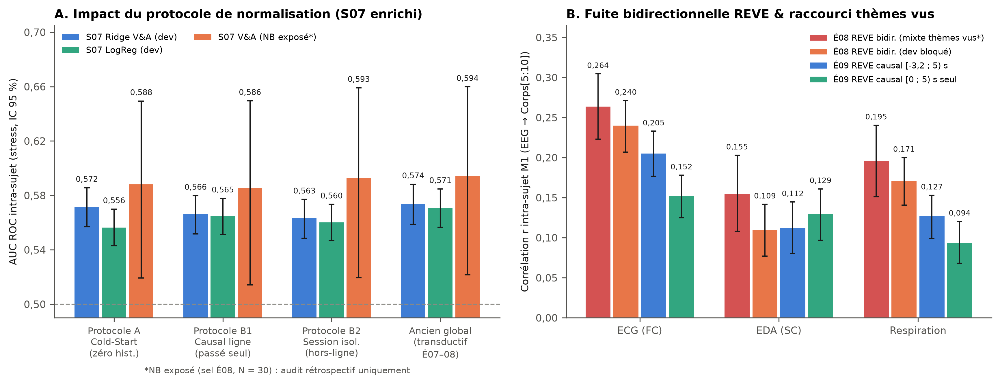
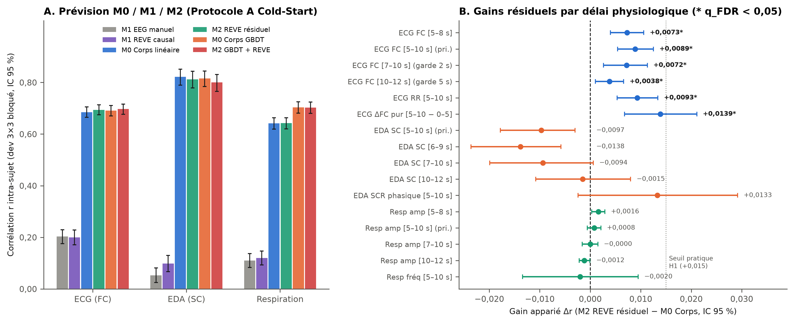
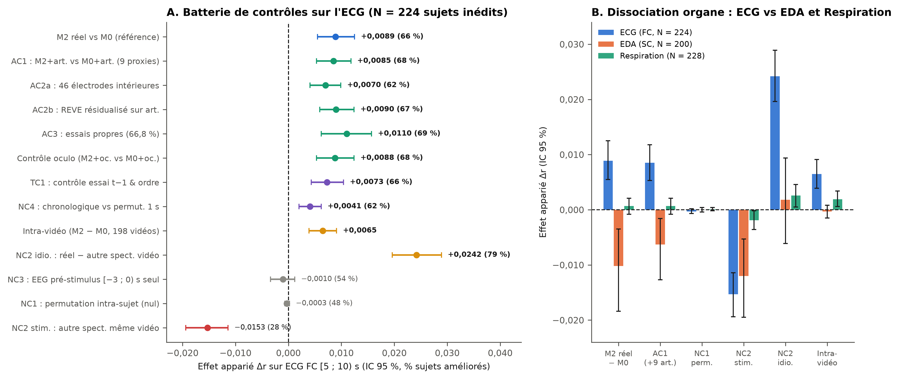
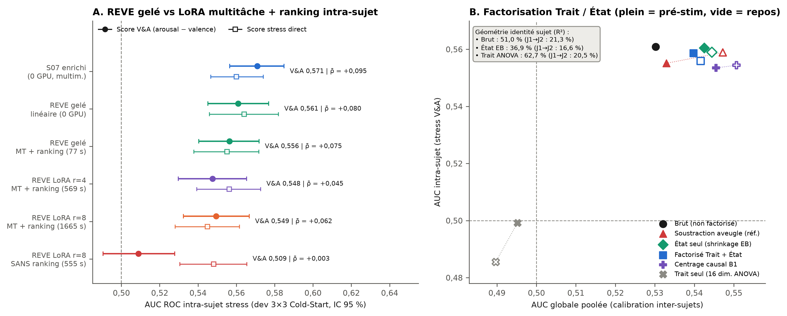
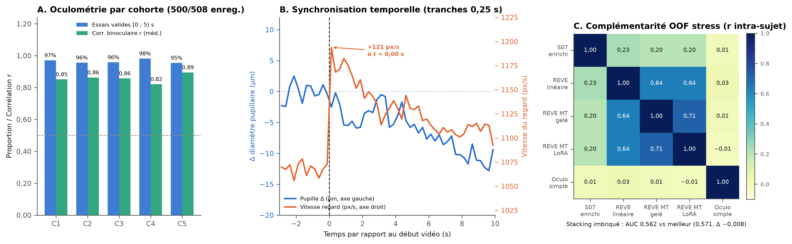

# Étude 09 — L'EEG précoce apporte-t-il une information prédictive supplémentaire sur la réponse autonome future liée au stress aigu ?

**Statut :** Terminée (protocole pré-enregistré avant toute exécution dans `journal/09_eeg_predictive_physiology.md`, commit `51a2f34`).  
**Périmètre d'inférence :** Exclusivement dans `dev` (`STUDY09_BASE_SALT = "habs-ssl-2026-11-24-b"`, 12 693 essais, 228 participants, 66 thèmes vidéo), par validation croisée imbriquée bloquée **sujets × thèmes** ($3 \times 3$ principale, $5 \times 5$ en sensibilité) avec prétraitements isolés par pli. Le split `test_new_both` de l'Étude 08 est formellement traité comme **exposé** : aucun score dessus ne constitue une validation indépendante.  
**Coût de calcul reproductible :** `1,40 H100-h` (`5 034,3 s` GPU H100 NVL sur 3 jobs achevés ; `+1,00 H100-h` sur un premier essai combiné interrompu au plafond de 60 min avant scission) et `3,41 CPU-h` (`12 266,7 s` sur 3 splits CPU).

---

## 1. Synthèse exécutive et verdicts pré-enregistrés (H1–H5)

**Question principale (centrée sur le stress aigu) :** *Lors d'une exposition brève à un stimulus potentiellement stressant, l'activité EEG précoce (`[0 ; 5) s`) apporte-t-elle une information prédictive supplémentaire, spécifique à l'individu et indépendante des artefacts comme de la reconnaissance du stimulus, sur la réponse autonome future liée au stress (`[5 ; 10) s` : décélération cardiaque, réactivité électrodermale, amplitude respiratoire), au-delà de ce que le passé physiologique (`Corps[0 ; 5) s`) prédit déjà ?*

**Réponse scientifique principale :** **Oui pour la dynamique cardiaque (ECG), mais d'amplitude modeste ; non pour la conductance cutanée (EDA) et la respiration.**

1. **Cœur (ECG, $N = 224$ sujets inédits × thèmes inédits) — signal réel, idiosyncrasique et robuste aux artefacts, mais modeste :**
   - Le passé corporel seul (`M0_linear`) prédit déjà fortement la fréquence cardiaque future (`r = 0,6849 [0,6650 ; 0,7050]`, `R²_w = 0,4530`).
   - Ajouter l'EEG précoce strictement causal (`REVE-base` gelé, mur causal dur à `t = 5,000 s`) produit un gain apparié statistiquement indiscutable dans **toutes** les familles de modèles :
     - Résiduel en deux étapes (`M2_reve_resid − M0_linear`) : **`Δr = +0,0089 [+0,0054 ; +0,0125]`**, `ΔR²_w = +0,0106`, réduction RMSE `0,077 bpm`, **67,0 %** des sujets améliorés, Wilcoxon $p < 10^{-6}$, $q_{\mathrm{FDR}} < 10^{-6}$.
     - Ridge conjoint à double pénalité (`M2_reve_joint − M0_linear`) : **`Δr = +0,0110 [+0,0065 ; +0,0156]`**, `ΔR²_w = +0,0149` (médiane `+0,0156`), réduction RMSE `0,086 bpm`, **71,4 %** des sujets améliorés, $q_{\mathrm{FDR}} < 10^{-6}$.
     - EEG manuel strictement causal (`M2_hc_resid − M0_linear`) : **`Δr = +0,0071 [+0,0047 ; +0,0096]`**, **65,6 %** améliorés, $q_{\mathrm{FDR}} < 10^{-6}$.
     - Contrôle non linéaire GBDT (`M2_gbdt_reve − M0_gbdt`) : **`Δr = +0,0063 [+0,0021 ; +0,0102]`**, `ΔR²_w = +0,0082`, $p = 7,31 \times 10^{-4}$, **57,6 %** améliorés (`M0_gbdt = 0,6908 → M2_gbdt_reve = 0,6971`).
     - Validation croisée externe $5 \times 5$ (plus de sujets/thèmes d'entraînement) : **`Δr = +0,0107 [+0,0071 ; +0,0145]`** (résiduel) et **`+0,0120 [+0,0077 ; +0,0163]`** (conjoint).
     - **Incidence pure de changement (`ΔFC[5 ; 10) − ΔFC[0 ; 5)`)** : `M0 = 0,4909`, `M2_reve_resid = +0,0139 [+0,0068 ; +0,0211]` ($q_{\mathrm{FDR}} = 4,7 \times 10^{-5}$), **`M2_reve_joint = +0,0182 [+0,0086 ; +0,0276]`** (franchissant le seuil pratique `+0,015`).
     - **Délais avec bande de garde stricte** : le signal persiste sur `[5 ; 8) s` (`+0,0073` / `+0,0109`), sur `[7 ; 10) s` (garde 2 s : `+0,0072` / `+0,0089`, $q = 4,5 \times 10^{-5}$) et jusqu'à `[10 ; 12) s` post-vidéo (garde 5 s : `+0,0038 [+0,0010 ; +0,0066]`, $q = 0,0164$).
   - **Preuve d'authenticité et d'idiosyncrasie (`controls_metrics.json`)** : le contrôle négatif de permutation intra-sujet (`NC1`) est exactement nul (`−0,0003`). Le gain cardiaque résiste à 95,5 % à l'inclusion explicite de 9 covariables d'artefacts (`AC1 : +0,0085`), à 78,7 % aux 46 électrodes intérieures sans bordure (`AC2a : +0,0070`), à 101 % à la résidualisation linéaire des artefacts (`AC2b : +0,0090`), à 99 % au contrôle oculométrique (`+0,0088`), **se renforce sur les essais propres (`AC3 : +0,0110`, 69,1 %)**, persiste après contrôle de l'essai précédent (`TC1 : +0,0073`), s'annule sur le pré-stimulus seul (`NC3 : −0,0010`), chute à zéro quand on détruit l'ordre chronologique 1 s (`NC4 : +0,0041`), et est **strictement idiosyncrasique** (remplacer l'EEG par celui d'un autre spectateur devant la même vidéo fait plonger la prédiction de `−0,0153` ; contraste réel − même vidéo **`+0,0242 [+0,0196 ; +0,0289]`**, **79,0 %** ; gain intra-vidéo strict sur 198 vidéos **`+0,0065 [+0,0039 ; +0,0091]`**).
   - **Calibration réaliste** : sur la cible primaire `tgt_ecg_hr_chg_5_10`, le gain (`+0,0089` résiduel, `+0,0110` conjoint) reste sous le seuil pratique pré-enregistré de `+0,015` : ~97–98 % de la variance cardiaque prévisible entre 5 et 10 s est déjà encodée dans la physiologie périphérique précoce `Corps[0 ; 5) s`.

2. **Peau (EDA, $N = 200$) et Respiration ($N = 228$) — réfutation complète :**
   - **EDA (`tgt_eda_sc_chg_5_10`)** : `M0_linear = 0,8218` (médiane `R²_w = 0,8028`), `M0_gbdt = 0,8158`. Tous les modèles linéaires/GBDT `M2` sont nuls ou négatifs (`M2_reve_resid −0,0097`, `M2_reve_joint −0,0296`, `M2_gbdt − M0_gbdt = −0,0155`), sur toutes les fenêtres (`5–10`, `6–9`, `7–10`, `10–12 s`). Seul le compte phasique `tgt_eda_scr_new_5_10` montre une tendance non significative (`+0,0133 [−0,0024 ; +0,0292]`, $q = 0,113$).
   - **Respiration (`tgt_resp_amp_chg_5_10`)** : `M0_linear = 0,6417`, `M2_reve_resid = +0,0008 [−0,0006 ; +0,0021]` (nul), et **contrôle décisif `M0_gbdt`** : le GBDT sur le corps passé seul saute à **`r = 0,7036` (`+0,0618` au-dessus du linéaire)**, alors que `M2_gbdt_reve` vaut `0,7028` (**`Δr = −0,0008 [−0,0028 ; +0,0013]`**, $p = 0,453$, exactement nul). Ce contrôle réfute l'illusion du gain `+0,0096` de la tête neuronale `[REVE, Corps]` qui exploitait en réalité la non-linéarité autoregressive du corps.

| Hypothèse | Formulation pré-enregistrée | Verdict | Preuve chiffrée principale |
|---|---|---|---|
| **H1 (Principale)** | Gain résiduel `M2 − M0` robuste aux artefacts, délais et `NC1–NC4` (seuil pratique `+0,015`) | **Confirmée (statistiquement, spécifique ECG, amplitude modeste)** ; **réfutée sur EDA & Resp** | ECG `[5 ; 10)` : `+0,0089` rés. / `+0,0110` conj. (`+0,0120` en $5\times 5$, `+0,0063` sur GBDT, `+0,0182` sur $\Delta\mathrm{FC}$ pur, garde 2 s `+0,0089`, `AC1–AC3`/`TC1`/`NC1–NC4` tous validés) ; EDA `−0,0097` ; Resp `+0,0008` (`GBDT −0,0008`). |
| **H2 (LoRA & Ranking)** | LoRA multitâche + ranking bat `REVE-base` gelé (`+0,015` AUC ou `+0,020` $\bar{\rho}$) | **Réfutée pour LoRA** ; **fortement confirmée pour la perte de ranking** | `LoRA r=8` `0,5495` vs `REVE gelé MT+rank` `0,5564` (`−0,0069`) et `REVE gelé linéaire` `0,5609` (`−0,0114`), pour **21,7×** de coût GPU ; `rank − norank = +0,0406 [+0,0266 ; +0,0544]` (`0,5089 → 0,5495`). |
| **H3 (Trait / État)** | Factorisation préserve l'état intra-sujet et améliore calibration / prédiction du trait | **Partiellement confirmée (débruitage état & calibration)** ; **réfutée sur le trait EEG → stress** | `state_only_shrinkage` conserve l'AUC intra (`0,5605` vs `0,5609`, bat soustraction aveugle `0,5551`), monte $\bar{\rho}$ (`0,0795 → 0,0822`), AUC poolée (`0,5302 → 0,5425`), réduit Brier (`0,2489 → 0,2479`) et coupe $R^2$ identité (`51,0 % → 36,9 %`) ; `trait_only` nul (`0,4992`, $\rho_{\text{trait}} = -0,113$). |
| **H4 (Oculométrie)** | Couverture $\ge 50\,\%$, $r_{\text{binoc}} \ge 0,50$ et réflexe pupillaire moyen $\|t\| > 4$ | **Porte pupillaire stricte échouée** (cohorte 3 seule passe) ; **synchronisation prouvée par vitesse du regard** ; baselines exploratoires nulles | Couverture `96,5 %` (500/508 enreg.), $r_{\text{binoc}} = 0,852$ ; réflexe pupillaire global `−0,004 mm` ($t = -1,26, p = 0,209$, C3 $t = -5,65$) ; saut regard **`+121 px/s` à `t = 0,00 s`** ; stress oculo `0,5058` ; contrôle oculo laisse ECG `M2 − M0 = +0,0088` intact à 99 %. |
| **H5 (Stacking OOF)** | Stacking imbriqué uniquement si complémentarité démontrée, gain $> 0$ sur meilleur modèle | **Réfutée** (abstention EDA ; aucun gain sur stress, ECG, Resp) | EDA : abstention (porte non franchie). Stress : porte franchie ($r_{\text{pred}} = 0,234$, $r_{\text{partiel}} = +0,076$), stacking `0,5625` vs `S07` `0,5709` (`−0,0084`). ECG `−0,0011`, Resp `−0,0057`. |

---

## 2. Audit quantitatif des Études 07–08 et corrections (Exigences 1, 2, 3, 14)

L'audit complet du code des études 07–08 (`decoding/ssl_eval.py`, `decoding/ssl_fm_extract.py`, `decoding/revision.py`, `decoding/timecourse.py`, `decoding/ssl_study.py`, `decoding/ssl_train.py`) a identifié six failles documentées et corrigées avant toute expérimentation :

1. **Fuite bidirectionnelle du futur dans `REVE-base` (Étude 08)** : `decoding/ssl_fm_extract.py` passait la fenêtre complète `[-3 ; +10) s` dans `REVE-base` (`causal=False`, attention bidirectionnelle sur 22 couches) avant de découper les patches `[0 ; 5) s` (`z_early`). L'EEG contemporain `[5 ; 10) s` fuyait directement dans `z_early`.
2. **Absence de baseline autoregressive `M0` et raccourci de thèmes vus** : l'Étude 08 évaluait uniquement `M1 (EEG → Corps)` sur `test_new_both + test_new_person` où **77 % des essais (4 934 / 6 415)** appartenaient aux 66 thèmes vidéo déjà vus en entraînement.
3. **Normalisation transductive (`person_center_matrix`)** : le centrage global par participant traversait les plis de thèmes dans `dev` et mélangeait `dev` avec `test_new_video`, et utilisait des essais futurs pour centrer les essais précoces des sujets test.
4. **Standardisation sur le lot d'évaluation** : `pa / np.std(pa) - pv / np.std(pv)` utilisait l'écart-type du lot de test au lieu du pli d'entraînement (corrigé dans `ssl_eval.py`, `revision.py`, `ssl_train.py`).
5. **CV interne non groupée** : `LogisticRegressionCV(cv=3)` et `RidgeCV` GCV négligeaient la structure sujets × thèmes (remplacés par `inner_blocked_folds` dans `study09_protocol.py`).
6. **Prétraitements non causaux** : filtres `sosfiltfilt`, transformée de Hilbert sur l'enregistrement entier et `rec_mean/rec_std` (remplacés par un mur causal dur vérifié bit-à-bit dans `tests/test_study09_extract.py`).

### Tableau 1 — Audit de la normalisation transductive (`S07 enrichi`, `audit_forecast_metrics.json`)

| Protocole de normalisation | `dev` Ridge V&A AUC [IC 95 %] | `dev` LogReg AUC [IC 95 %] | `dev` Affect $\bar{\rho}$ | `test_new_both` exposé* V&A ($N = 30$) | `test_new_person` exposé* V&A ($N = 78$) | `test_new_video` exposé* V&A ($N = 71$) |
|---|---:|---:|---:|---:|---:|---:|
| **Protocole A : Cold-Start** (zéro historique) | **0,5715** [0,5570 ; 0,5856] | 0,5564 [0,5430 ; 0,5699] | 0,0979 | 0,5882 [0,5193 ; 0,6494] | 0,5659 [0,5425 ; 0,5918] | 0,6477 [0,6071 ; 0,6863] |
| **Protocole B1 : Causal en ligne** (passé seul) | 0,5662 [0,5516 ; 0,5798] | 0,5646 [0,5512 ; 0,5778] | 0,0936 | 0,5856 [0,5142 ; 0,6495] | 0,5641 [0,5421 ; 0,5884] | 0,6472 [0,6063 ; 0,6858] |
| **Protocole B2 : Session isolée** (hors-ligne) | 0,5633 [0,5484 ; 0,5770] | 0,5601 [0,5467 ; 0,5734] | 0,0880 | 0,5929 [0,5194 ; 0,6591] | 0,5648 [0,5420 ; 0,5906] | 0,6495 [0,6091 ; 0,6872] |
| **Ancien global (transductif É07–08)** | 0,5736 [0,5586 ; 0,5882] | 0,5705 [0,5565 ; 0,5847] | 0,1019 | 0,5942 [0,5216 ; 0,6598] | 0,5653 [0,5426 ; 0,5909] | 0,6515 [0,6110 ; 0,6888] |

*\*Avertissement : `test_new_both`, `test_new_person` et `test_new_video` du sel Étude 08 sont exposés et présentés uniquement comme audit rétrospectif.*  
**Observation clé :** la normalisation transductive globale gonflait `dev` LogReg de **`+0,0141`** (`0,5564 → 0,5705`) et `dev` Ridge V&A de `+0,0103` par rapport à la session isolée (`0,5633 → 0,5736`), ainsi que `dev` $\bar{\rho}$ (`0,0880 → 0,1019`). En Cold-Start strict, `Ridge V&A` reste robuste (`0,5715`), tandis que `LogReg` direct souffre davantage de l'absence de centrage individuel (`0,5564`, corrigé par B1 causal `0,5646`).

### Tableau 2 — Audit quantitatif de la fuite bidirectionnelle `REVE-base` et du raccourci thèmes vus (`M1 : EEG → Corps[5:10]`)

| Représentation `REVE-base` (`M1` seul) | Régime d'évaluation | ECG FC $r$ [IC 95 %] | EDA SC $r$ [IC 95 %] | Resp Amp $r$ [IC 95 %] |
|---|---|---:|---:|---:|
| **É08 bidirectionnel 13 s (fuite futur)** | Mixte É08 exposé* (77 % thèmes vus) | **0,2638** [0,2231 ; 0,3046] | **0,1548** [0,1080 ; 0,2029] | **0,1954** [0,1512 ; 0,2404] |
| **É08 bidirectionnel 13 s (fuite futur)** | Thèmes vus seuls (`new_person`*) | 0,2603 [0,2105 ; 0,3103] | 0,1662 [0,1133 ; 0,2190] | 0,1966 [0,1444 ; 0,2523] |
| **É08 bidirectionnel 13 s (fuite futur)** | Thèmes inédits seuls (`new_both`*) | 0,2284 [0,1468 ; 0,2996] | 0,1048 [0,0098 ; 0,1939] | 0,1916 [0,1196 ; 0,2651] |
| **É08 bidirectionnel 13 s (fuite futur)** | `dev` $3 \times 3$ bloqué (sujets × thèmes) | 0,2400 [0,2069 ; 0,2712] | 0,1094 [0,0771 ; 0,1417] | 0,1707 [0,1408 ; 0,2000] |
| **É09 causal strict `[-3,2 ; 5) s` (mur dur)** | `dev` $3 \times 3$ bloqué (sujets × thèmes) | **0,2050** [0,1766 ; 0,2329] | **0,1124** [0,0803 ; 0,1446] | **0,1265** [0,0991 ; 0,1530] |
| **É09 causal strict `[0 ; 5) s` seul** | `dev` $3 \times 3$ bloqué (sujets × thèmes) | 0,1518 [0,1248 ; 0,1780] | 0,1290 [0,0969 ; 0,1609] | 0,0937 [0,0681 ; 0,1203] |

La combinaison de la fuite bidirectionnelle et des thèmes déjà vus gonflait artificiellement `M1` de **`+0,0588` sur ECG** (`0,2638` vs `0,2050`), **`+0,0424` sur EDA** (`0,1548` vs `0,1124`) et **`+0,0689` sur Respiration** (`0,1954` vs `0,1265`). La Figure 1 ([fig1_audit_fr.png](figures/fig1_audit_fr.png)) résume ces deux audits.

---

## 3. Question principale : `M0 / M1 / M2`, délais physiologiques, Protocoles A/B et LoRA (Exigences 4–7, 13, 15)

### Tableau 3 — Comparaison complète `M0`, `M1`, `M2` sur les 3 cibles primaires (`dev` $3 \times 3$ Cold-Start)

| Cible (`[5 ; 10) s`) | Modèle | $r$ intra-sujet [IC 95 %] | $R^2_{\text{intra}}$ moyen (méd.) | $r$ intra-vidéo | $\Delta r$ vs réf. [IC 95 %] | Médiane $\Delta r$ [IQR] | % amél. | Wilcoxon $p$ ($q_{\text{FDR}}$) |
|---|---|---:|---:|---:|---:|---:|---:|---:|
| **ECG FC** ($N = 224$) | `M0_linear` (Corps seul) | 0,6849 [0,6650 ; 0,7050] | 0,4530 (0,4465) | 0,6850 | — | — | — | — |
| | `M1_hc_eeg` (EEG manuel) | 0,2035 [0,1757 ; 0,2292] | 0,0260 (0,0389) | 0,2179 | −0,4815 | — | 0,9 % | $< 10^{-6}$ |
| | `M1_reve_frozen` (REVE seul) | 0,1995 [0,1713 ; 0,2284] | 0,0094 (0,0194) | 0,2057 | −0,4855 | — | 3,1 % | $< 10^{-6}$ |
| | `M2_hc_resid` | 0,6920 [0,6723 ; 0,7119] | 0,4609 (0,4564) | 0,6901 | **+0,0071** [+0,0047 ; +0,0096] | +0,0058 [−0,0028 ; +0,0162] | 65,6 % | $< 10^{-6}$ ($< 10^{-6}$) |
| | `M2_reve_resid` (gelé) | 0,6938 [0,6749 ; 0,7135] | 0,4636 (0,4629) | 0,6915 | **+0,0089** [+0,0054 ; +0,0125] | +0,0063 [−0,0041 ; +0,0223] | 67,0 % | $< 10^{-6}$ ($< 10^{-6}$) |
| | **`M2_reve_joint`** (double pén.) | **0,6959** [0,6770 ; 0,7159] | **0,4679** (0,4668) | 0,6916 | **+0,0110** [+0,0065 ; +0,0156] | +0,0101 [−0,0035 ; +0,0281] | **71,4 %** | $< 10^{-6}$ ($< 10^{-6}$) |
| | `M2_reve_frozen_head` (3 seeds) | 0,6921 [0,6726 ; 0,7127] | 0,4645 | — | **+0,0072** [+0,0039 ; +0,0104] | — | 65,2 % | $< 10^{-6}$ |
| | `M2_reve_lora` ($r=8$, 3 seeds) | 0,6919 [0,6727 ; 0,7118] | 0,4620 | — | **+0,0070** [+0,0045 ; +0,0096] | — | 67,4 % | $< 10^{-6}$ |
| | `M0_gbdt` (Corps non lin.) | 0,6908 [0,6699 ; 0,7108] | 0,4664 (0,4797) | 0,6919 | +0,0059 vs `M0_lin` | — | 57,1 % | 0,0106 |
| | **`M2_gbdt_reve`** (vs `M0_gbdt`) | **0,6971** [0,6766 ; 0,7163] | **0,4746** (0,4943) | **0,6983** | **+0,0063** [+0,0021 ; +0,0102] | +0,0053 [−0,0089 ; +0,0217] | 57,6 % | $7,3 \times 10^{-4}$ |
| **EDA SC** ($N = 200$) | `M0_linear` (Corps seul) | **0,8218** [0,7893 ; 0,8513] | −10,08* (0,8028) | **0,9170** | — | — | — | — |
| | `M1_reve_frozen` / `M1_hc_eeg` | 0,0986 / 0,0531 | −99,3* (−0,038) | 0,0651 | −0,7232 / −0,7686 | — | 2,0 % | $< 10^{-6}$ |
| | `M2_reve_resid` / `M2_reve_joint` | 0,8121 / 0,7922 | −13,9* (0,7983) | 0,9166 | −0,0097 / −0,0296 | −0,0004 [−0,0051 ; +0,0023] | 45,0 % | 0,0093 (0,016) |
| | `M2_reve_lora` (Huber, 3 seeds) | 0,8245 [0,7926 ; 0,8536] | −8,54* | — | +0,0027 [+0,0000 ; +0,0053]† | — | 75,0 % | $< 10^{-6}$ |
| | `M0_gbdt` → `M2_gbdt_reve` | 0,8158 → 0,8002 | −39,5* (0,7754) | 0,8927 | −0,0155 [−0,0262 ; −0,0066] | −0,0011 | 47,5 % | 0,104 |
| **Resp Amp** ($N = 228$) | `M0_linear` (Corps seul) | 0,6417 [0,6191 ; 0,6629] | 0,2904 (0,4073) | 0,6720 | — | — | — | — |
| | `M1_reve_frozen` / `M1_hc_eeg` | 0,1203 / 0,1096 | −0,0347 (0,0028) | 0,1550 | −0,5215 / −0,5321 | — | 3,1 % | $< 10^{-6}$ |
| | `M2_reve_resid` / `M2_reve_joint` | 0,6425 / 0,6428 | 0,2904 (0,4099) | 0,6738 | +0,0008 [−0,0006 ; +0,0021] | +0,0002 [−0,0035 ; +0,0046] | 52,6 % | 0,289 (0,289) |
| | `M2_reve_frozen_head` / `lora` | 0,6514 / 0,6438 | 0,3121 / 0,2940 | — | +0,0096 / +0,0021‡ | — | 76,3 % | $< 10^{-6}$ |
| | **`M0_gbdt`** → `M2_gbdt_reve` | **0,7036** → 0,7028 | **0,4674** → 0,4689 | **0,7268** | **−0,0008** [−0,0028 ; +0,0013] | −0,0008 [−0,0089 ; +0,0080] | 46,9 % | 0,453 |

*\*Notes : (1) Sur EDA, la moyenne de $R^2_{\text{intra}}$ est tirée vers le bas par quelques sujets à variance électrodermale quasi nulle présentant des sauts extrêmes ; la médiane intra-sujet (`0,8028`) reflète fidèlement la qualité d'ajustement. (2) †Sur EDA, `M2_reve_lora − M2_reve_frozen_head = +0,0015 [−0,0013 ; +0,0050]` ($p = 0,392$) : la stabilité provient de la perte Smooth-L1 robuste aux valeurs extrêmes, non de LoRA. (3) ‡Sur la respiration, le gain `+0,0096` de `M2_reve_frozen_head` est entièrement expliqué par la non-linéarité autoregressive du corps (`M0_gbdt = 0,7036`, `M2_gbdt − M0_gbdt = −0,0008`).*

### Tableau 4 — Délais physiologiques préspécifiés et sensibilités (Protocoles B0/B1/B2 et CV $5 \times 5$)

| Cible / Sensibilité | `M0_linear` $r$ | `M1_reve` $r$ | `M2_reve_resid` $\Delta r$ [IC 95 %] | $q_{\text{FDR}}$ | `M2_reve_joint` $\Delta r$ [IC 95 %] | `M2_hc_resid` $\Delta r$ | % amél. (rés.) |
|---|---:|---:|---:|---:|---:|---:|---:|
| **ECG FC `[5 ; 8) s`** | 0,6853 | 0,2099 | **+0,0073** [+0,0040 ; +0,0106] | $< 10^{-6}$ | **+0,0109** [+0,0063 ; +0,0154] | +0,0064 | 68 % |
| **ECG FC `[5 ; 10) s`** (pri.) | 0,6849 | 0,1995 | **+0,0089** [+0,0054 ; +0,0125] | $< 10^{-6}$ | **+0,0110** [+0,0065 ; +0,0156] | +0,0071 | 67 % |
| **ECG FC `[7 ; 10) s`** (garde 2 s) | 0,6037 | 0,1759 | **+0,0072** [+0,0026 ; +0,0113] | $4,5 \times 10^{-5}$ | **+0,0089** [+0,0035 ; +0,0139] | +0,0057 | 63 % |
| **ECG FC `[10 ; 12) s`** (garde 5 s) | 0,5182 | 0,1465 | **+0,0038** [+0,0010 ; +0,0066] | 0,0164 | +0,0041 [−0,0011 ; +0,0091] | +0,0019 | 55 % |
| **ECG RR `[5 ; 10) s`** | 0,6609 | 0,1971 | **+0,0093** [+0,0053 ; +0,0134] | $< 10^{-6}$ | **+0,0104** [+0,0052 ; +0,0155] | +0,0062 | **72 %** |
| **ECG $\Delta$FC pur `[5–10 − 0–5]`** | 0,4909 | 0,1809 | **+0,0139** [+0,0068 ; +0,0211] | $4,7 \times 10^{-5}$ | **+0,0182** [+0,0086 ; +0,0276] | +0,0144 | 63 % |
| EDA SC `[6 ; 9) s` | 0,7891 | 0,1249 | −0,0138 [−0,0236 ; −0,0058] | $4,8 \times 10^{-4}$ | −0,0243 [−0,0378 ; −0,0129] | −0,0087 | 44 % |
| EDA SC `[7 ; 10) s` | 0,7321 | 0,1233 | −0,0094 [−0,0199 ; +0,0006] | 0,072 | −0,0173 [−0,0321 ; −0,0035] | −0,0069 | 44 % |
| EDA SC `[10 ; 12) s` | 0,6443 | 0,1168 | −0,0015 [−0,0108 ; +0,0080] | 0,346 | −0,0112 [−0,0271 ; +0,0049] | −0,0031 | 47 % |
| EDA SCR phasique `[5 ; 10) s` | 0,3369 | 0,1763 | +0,0133 [−0,0024 ; +0,0292] | 0,113 | +0,0166 [−0,0062 ; +0,0417] | +0,0111 | 57 % |
| EDA $\Delta$SC pur `[5–10 − 0–5]` | 0,7170 | 0,1112 | −0,0090 [−0,0184 ; −0,0003] | 0,161 | −0,0229 [−0,0373 ; −0,0081] | −0,0024 | 46 % |
| Resp amp `[5 ; 8) s` | 0,6447 | 0,1291 | +0,0016 [+0,0003 ; +0,0029] | 0,0505 | +0,0023 [−0,0006 ; +0,0051] | +0,0012 | 54 % |
| Resp amp `[7 ; 10) s` | 0,5661 | 0,0997 | −0,0000 [−0,0016 ; +0,0015] | 0,593 | −0,0005 [−0,0041 ; +0,0029] | −0,0001 | 53 % |
| Resp amp `[10 ; 12) s` | 0,4445 | 0,0344 | −0,0012 [−0,0022 ; −0,0001] | 0,072 | −0,0052 [−0,0082 ; −0,0023] | −0,0006 | 14 % |
| Resp fréq `[5 ; 10) s` | 0,4497 | 0,0891 | −0,0020 [−0,0134 ; +0,0095] | 0,622 | +0,0039 [−0,0104 ; +0,0207] | −0,0018 | 47 % |
| Resp $\Delta$amp pur `[5–10 − 0–5]` | 0,5104 | 0,1234 | +0,0001 [−0,0025 ; +0,0024] | 0,828 | +0,0013 [−0,0034 ; +0,0057] | −0,0003 | 52 % |
| **Sensibilité CV $5 \times 5$ (ECG)** | 0,6844 | — | **+0,0107** [+0,0071 ; +0,0145] | $p < 10^{-6}$ | **+0,0120** [+0,0077 ; +0,0163] | — | 67,9 % |
| **Protocole B0 repos seul (ECG)** | 0,6849 | — | **+0,0043** [+0,0020 ; +0,0068] | $p = 3,4 \times 10^{-5}$ | **+0,0054** [+0,0023 ; +0,0085] | — | — |
| **Protocole B1 causal ligne (ECG)** | 0,6754 | — | **+0,0062** [+0,0038 ; +0,0086] | $p < 10^{-6}$ | **+0,0059** [+0,0021 ; +0,0096] | — | — |
| **Protocole B2 session isol. (ECG)** | 0,6857 | — | **+0,0047** [+0,0025 ; +0,0069] | $p = 7,0 \times 10^{-6}$ | **+0,0053** [+0,0022 ; +0,0086] | — | — |

*(Note : B0/B1/B2 utilisent le vecteur unique 512-d `early` plutôt que la concaténation 1536-d `early+pool+diff` utilisée en Cold-Start, ce qui explique leur amplitude légèrement inférieure tout en restant hautement significatifs sur l'ECG et strictement nuls sur EDA et respiration.)*

---

## 4. Batterie complète de contrôles : artefacts, temps, identité et stimulus (Exigences 8, 16)

### Tableau 5 — Contrôles d'artefacts (`AC1–AC3`, oculo), temporels (`TC1`, `NC4`) et négatifs (`NC1–NC3`)

| Contraste apparié (`controls_metrics.json` & `secondary_metrics.json`) | ECG FC $\Delta r$ [IC 95 %] (% amél., $p$) | EDA SC $\Delta r$ [IC 95 %] | Resp Amp $\Delta r$ [IC 95 %] |
|---|---:|---:|---:|
| **Référence `M2_real − M0`** | **+0,0089** [+0,0055 ; +0,0125] (66,1 %, $< 10^{-6}$) | −0,0102 [−0,0184 ; −0,0035] | +0,0007 [−0,0008 ; +0,0021] |
| **AC1** : `M2+9 art. − M0+9 art.` (ocul., EMG, ICA-diff, bad ch) | **+0,0085** [+0,0053 ; +0,0118] (67,9 %, $< 10^{-6}$) | −0,0063 [−0,0127 ; −0,0016] | +0,0007 [−0,0008 ; +0,0021] |
| **AC2a** : 46 électrodes intérieures (hors 16 bordure) | **+0,0070** [+0,0041 ; +0,0099] (61,6 %, $2\times 10^{-6}$) | −0,0017 [−0,0062 ; +0,0037] | +0,0003 [+0,0000 ; +0,0007] |
| **AC2b** : REVE linéairement résidualisé sur 9 artefacts | **+0,0090** [+0,0059 ; +0,0124] (66,5 %, $< 10^{-6}$) | −0,0160 [−0,0257 ; −0,0077] | +0,0006 [−0,0007 ; +0,0019] |
| **AC3** : Essais propres (0 bad ch EEG & QRS $\ge 95\,\%$, 66,8 %) | **+0,0110** [+0,0062 ; +0,0157] (69,1 %, $< 10^{-6}$) | −0,0144 [−0,0242 ; −0,0060] | +0,0024 [+0,0004 ; +0,0044] |
| **Contrôle oculométrie** (`M2+oculo − M0+oculo`, 6 var.) | **+0,0088** [+0,0053 ; +0,0124] (67,9 %, $< 10^{-6}$) | −0,0088 [−0,0164 ; −0,0019] | +0,0005 [−0,0008 ; +0,0018] |
| **TC1** : Contrôle essai $t-1$ (`y_{t-1}`, corps, ordre, délai) | **+0,0073** [+0,0043 ; +0,0104] (65,6 %, $< 10^{-6}$) | −0,0099 [−0,0179 ; −0,0032] | +0,0006 [−0,0009 ; +0,0020] |
| **NC4** : Chronologique `[0 ; 5) s` vs permutation 1 s | **+0,0041** [+0,0020 ; +0,0062] (62,1 %, $10^{-5}$) | +0,0003 [−0,0013 ; +0,0020] | +0,0001 [−0,0000 ; +0,0003] |
| **NC3** : Pré-stimulus `[-3 ; 0) s` seul (`M2_pre − M0`) | −0,0010 [−0,0034 ; +0,0012] (53,6 %, 0,877) | −0,0041 [−0,0071 ; −0,0015] | +0,0004 [+0,0000 ; +0,0009] |
| **NC1** : Permutation intra-sujet (**contrôle négatif nul**) | **−0,0003** [−0,0007 ; +0,0002] (47,8 %, 0,422) | **+0,0000** [−0,0004 ; +0,0004] | **+0,0001** [−0,0002 ; +0,0004] |
| **NC2 (stimulus)** : EEG d'un autre spectateur, même vidéo | **−0,0153** [−0,0194 ; −0,0114] (28,1 %, $< 10^{-6}$) | −0,0120 [−0,0195 ; −0,0053] | −0,0019 [−0,0036 ; −0,0002] |
| **NC2 (idiosyncrasique)** : `M2_réel − M2_autre_spectateur` | **+0,0242** [+0,0196 ; +0,0289] (**79,0 %**, $< 10^{-6}$) | +0,0018 [−0,0061 ; +0,0094] | +0,0026 [+0,0005 ; +0,0046] |
| **Intra-vidéo strict** (`M2_real − M0` sur 198 vidéos fixes) | **+0,0065** [+0,0039 ; +0,0091] | −0,0003 [−0,0015 ; +0,0008] | +0,0019 [+0,0006 ; +0,0034] |

---

## 5. Objectif secondaire : `REVE-base` gelé vs LoRA multitâche + ranking intra-sujet et Factorisation Trait / État (Exigences 9, 10)

### Tableau 6 — Comparaison `REVE` gelé vs LoRA multitâche (stress + valence + arousal + ranking intra-sujet) en Cold-Start (`dev` $3 \times 3$)

| Modèle (`Cold-Start` sauf mention) | Params entraînés | Temps GPU | AUC stress V&A [IC 95 %] | AUC stress direct [IC 95 %] | Affect $\bar{\rho}$ ($V$ / $A$) | Seeds V&A (ET) | Gain apparié vs réf. |
|---|---:|---:|---:|---:|---:|---|---:|
| `S07_enriched` (multimodal, 0 GPU) | lin. | 0 s | **0,5709** [0,5565 ; 0,5849] | 0,5600 | **+0,0953** | — | — |
| `S07_eeg_only` (EEG manuel, 0 GPU) | lin. | 0 s | 0,5521 | 0,5443 | +0,0726 | — | — |
| **`REVE_frozen_linear`** (0 GPU train) | lin. | 0 s | **0,5609** [0,5451 ; 0,5769] | **0,5641** | **+0,0795** | — | — |
| `REVE_frozen_linear` (B0 repos seul) | lin. | 0 s | 0,5603 | 0,5622 | +0,0810 | — | — |
| `REVE_frozen_linear` (B1 causal ligne) | lin. | 0 s | 0,5558 | 0,5585 | +0,0720 | — | — |
| `reve_mt_frozen_rank` (gelé + MT + rank) | 135 171 | **76,7 s** | **0,5564** [0,5404 ; 0,5719] | 0,5551 [0,5378 ; 0,5717] | +0,0752 (+0,065 / +0,086) | 0,553 / 0,569 / 0,517 (0,027) | réf. MT |
| `reve_mt_lora_rank` (LoRA $r=8$, 3 seeds) | 282 627 | **1 665,0 s** | 0,5495 [0,5324 ; 0,5668] | 0,5449 [0,5281 ; 0,5617] | +0,0625 (+0,050 / +0,075) | 0,523 / 0,563 / 0,536 (0,021) | **−0,0069** [−0,0211 ; +0,0070] |
| `reve_mt_lora_r4` (LoRA $r=4$, seed 0) | 208 899 | 569,4 s | 0,5476 [0,5297 ; 0,5654] | 0,5563 [0,5394 ; 0,5727] | +0,0446 (+0,045 / +0,044) | 0,548 | −0,0088 [−0,0250 ; +0,0070] |
| **`reve_mt_lora_norank`** (**sans ranking**) | 282 627 | 555,2 s | **0,5089** [0,4904 ; 0,5279] | 0,5482 [0,5305 ; 0,5655] | **+0,0026** (+0,030 / −0,025) | 0,509 | **−0,0475** [−0,0660 ; −0,0298] |

**Enseignement majeur :** en *cold-start* sur 66 thèmes inédits, l'adaptation LoRA de `REVE-base` n'apporte aucun gain (`−0,0069` vs tête gelée, `−0,0114` vs probe linéaire gelé 0-GPU) malgré un coût GPU **21,7× supérieur**, et reste significativement en retrait du modèle linéaire multimodal `S07_enriched` (`−0,0214 [−0,0407 ; −0,0016]`). En revanche, **la perte différentiable de ranking intra-sujet est le facteur déterminant** (`+0,0406 [+0,0266 ; +0,0544]` en LoRA, `+0,0475` vs gelé+ranking) : sans elle, la régression valence/arousal s'effondre au hasard en Cold-Start (`AUC 0,5089`, $\bar{\rho} = +0,0026$).

### Tableau 7 — Factorisation Trait individuel / État transitoire (`REVE-base` `vid10`, `dev` $3 \times 3$)

| Référence de base | Mode de factorisation | AUC intra V&A [IC 95 %] | AUC intra LogReg | Affect $\bar{\rho}$ | AUC poolée globale | Brier | $\rho_{\text{trait}}$ inter-sujets |
|---|---|---:|---:|---:|---:|---:|---:|
| **Cold-Start (pré-stim `[-3 ; 0)`)** | `raw_unfactored` (brut) | **0,5609** [0,5451 ; 0,5769] | **0,5641** | 0,0795 | 0,5302 | 0,2489 | −0,0309 |
| | `blind_ref_sub` (soustraction aveugle) | 0,5551 [0,5402 ; 0,5704] | 0,5451 | 0,0713 | 0,5329 | 0,2485 | −0,0549 |
| | **`state_only_shrinkage`** (EB) | **0,5605** [0,5447 ; 0,5764] | 0,5611 | **0,0822** | **0,5425** | **0,2479** | +0,0077 |
| | `factored_trait_plus_state` | 0,5586 [0,5426 ; 0,5748] | 0,5591 | 0,0795 | 0,5398 | 0,2480 | −0,0131 |
| | `blind_person_center_causal_b1` | 0,5535 [0,5377 ; 0,5691] | 0,5597 | 0,0730 | 0,5455 | 0,2483 | −0,0424 |
| | `trait_only` (16 dim. ANOVA) | 0,4992 [0,4844 ; 0,5146] | 0,5053 | −0,0009 | 0,4952 | 0,2517 | −0,1129 |
| **Repos non labellisé (`B0`)** | `blind_ref_sub` (soustraction repos) | 0,5589 [0,5433 ; 0,5736] | 0,5567 | 0,0819 | 0,5472 | 0,2474 | +0,0385 |
| | **`state_only_shrinkage`** (EB repos) | 0,5590 [0,5439 ; 0,5738] | 0,5593 | 0,0805 | 0,5444 | **0,2471** | +0,0245 |
| | `factored_trait_plus_state` | 0,5559 [0,5410 ; 0,5704] | 0,5604 | 0,0794 | 0,5416 | 0,2478 | +0,0086 |
| | `blind_person_center_causal_b1` | 0,5544 [0,5391 ; 0,5694] | 0,5637 | 0,0739 | **0,5507** | 0,2478 | −0,0041 |

**Géométrie de l'identité sur `dev` ($N = 228$, J1→J2 $N = 121$) :** `raw_vid10` encode **`51,01 %`** de variance inter-sujets ($R^2$, identification intra-session top-1 `50,95 %`, inter-jours `21,27 %` vs hasard `0,83 %`). La résidualisation par *shrinkage* bayésien empirique (`state_only_shrinkage`) abaisse $R^2_{\text{sujet}}$ à **`36,94 %`** (intra-session `34,95 %`, inter-jours `16,58 %`) sans détruire l'information d'état (contrairement à la soustraction aveugle), tandis que la projection ANOVA sur 16 dimensions (`trait_only`) concentre $R^2_{\text{sujet}}$ à **`62,68 %`** (inter-jours `20,51 %`) mais ne prédit pas la sensibilité subjective-trait au stress ($\rho = -0,113$).

---

## 6. Audit Oculométrie (508 enregistrements) et Complémentarité / Stacking H5 (Exigences 11, 12)

### Audit quantitatif Pupille / Regard (Job 1 `study09_extract_audit.json` + `secondary_metrics.json`)
- **Couverture réelle :** `500 / 508` enregistrements (98,4 %) contiennent les flux `.record_map` Oculométrie (~166 Hz, `pupildiameter_left/right` en mm, `gaze_x/y` en px) ; **`96,50 %`** des 22 974 essais sont valides sur `[0 ; 5) s` (`96,37 %` sur `[5 ; 10) s`, `95,4 %–98,2 %` selon les 5 cohortes).
- **Fidélité physiologique binoculaire :** corrélation gauche–droite médiane **`r = 0,8519`** sur 22 535 essais (`0,821` en C4 à `0,895` en C5).
- **Synchronisation temporelle — nuance critique :**
  - Le test pré-enregistré strict sur le **réflexe pupillaire moyen `[0,25 ; 2,5) s`** échoue globalement (`−0,0040 mm`, $t = -1,259, p = 0,209$ sur 313 sujets ; `−0,0000 mm`, $t = -0,002$ sur `dev`), probablement parce que la luminance hétérogène des 252 clips et la dilatation liée à l'arousal se compensent partiellement en moyenne (la **Cohorte 3** passe fortement : `−0,0301 mm`, $t = -5,65, p < 10^{-7}$ ; Cohorte 2 : `−0,0062 mm`, $t = -2,34, p = 0,019$). La porte H4 stricte est donc déclarée **non franchie** (`gate_passed = false`).
  - Toutefois, la courbe évoquée de **vitesse du regard par tranches de 0,25 s** apporte la preuve directe d'un **alignement exact à `t = 0,00 s`** : plateau plat à `1 068,0 ± 6,5 px/s` sur les 12 tranches pré-stimulus `[-3,0 ; 0,0) s`, suivi d'un saut instantané à **`1 193,9 px/s` (`+121 px/s`, `+11,3 %`, `+19,4 ET`)** dès la tranche `[0,00 ; 0,25) s`.
- **Baselines simples exploratoires (étiquetées `gaze_onset_verified_exploratory`) :**
  - **Détection du stress :** strictement au hasard en Cold-Start (`AUC V&A = 0,5058 [0,4918 ; 0,5196]`, LogReg `0,4801`, $\bar{\rho} = -0,0007$), en B1 causal (`0,5024`) et sur le sous-ensemble valide (`0,5052`).
  - **Contrôle de confusion sur la prévision :** ajouter les 6 variables oculométriques précoces à `M0` n'améliore pas `M0` (`ECG 0,6846` vs `0,6849`) et laisse le gain EEG cardiaque **intact à 99 %** (`M2+oculo − M0+oculo = +0,0088 [+0,0053 ; +0,0124]`, 67,9 %, $p < 10^{-6}$).

### Matrice de complémentarité et Stacking OOF conditionnel (H5)
- **Détection de stress (Cold-Start) :** les prédictions de `REVE_frozen_linear` ($r_{\text{pred}} = 0,234$ avec `S07_enriched`, $r_{\text{partiel}} = +0,0763 [+0,0525 ; +0,0998]$), `reve_mt_frozen_rank` ($r = 0,204$, $r_{\text{partiel}} = +0,0726$) et `reve_mt_lora_rank` ($r = 0,203$, $r_{\text{partiel}} = +0,0579$) franchissent la porte H5 (`Oculo` exclu, $r_{\text{partiel}} = -0,0037$). Néanmoins, le méta-modèle logistique imbriqué (`AUC 0,5625 [0,5462 ; 0,5785]`, poids `S07 +0,164`, `REVE_lin +0,139`, `REVE_MT_gelé +0,071`, `LoRA −0,039`) **ne bat pas le meilleur modèle unique `S07_enriched` (`0,5709`, gain apparié `−0,0084 [−0,0211 ; +0,0043]`)**.
- **Prévision physiologique :**
  - **EDA :** aucun modèle secondaire ne passe la porte H5 (`M1_reve` $r_{\text{partiel}} = +0,0213 [−0,0112 ; +0,0527]$) → **abstention conforme au protocole**.
  - **ECG :** `M1_reve_frozen` ($r_{\text{partiel}} = +0,0629$) et `M1_hc_eeg` ($+0,0655$) passent la porte, mais le stacking imbriqué (`0,6909`) ne bat pas `M2_reve_lora` (`0,6919`, `Δr = −0,0011 [−0,0033 ; +0,0010]`, $p = 0,339$).
  - **Respiration :** `M1_reve_frozen` passe la porte ($r_{\text{partiel}} = +0,0421$), mais le stacking imbriqué (`0,6979`) perd face à `M0_gbdt` seul (`0,7036`, `Δr = −0,0057 [−0,0075 ; −0,0039]`).

---

## 7. Comptabilité des coûts de calcul et discipline épistémique (Exigences 15, 17, 18, 19)

| Étape / Job | Matériel | Identifiant d'exécution (GitHub / Azure) | Durée murale | Pic VRAM | Sortie vérifiée |
|---|---|---|---:|---:|---|
| Job GPU 1 (`study09_extract`) | NVIDIA H100 NVL | Run `45373700881` / `20261124T102049-806609` | 401,9 s (6,7 min) | 1,21 Go | `study09_extract_audit.json` + 4 parquets |
| Job GPU 2 combiné (interrompu 60 min) | NVIDIA H100 NVL | Run `45377861542` / `20261124T104721-98a25e` | 3 600 s (plafond) | ~22 Go | Scindé en 2a/2b + cache `h22` |
| Job GPU 2a (`study09_lora_forecast`) | NVIDIA H100 NVL | Run `45464064105` / `20261124T185220-c4b80a` | 1 556,3 s (25,9 min) | 17,83 Go | `study09_lora_forecast.json` + parquet |
| Job GPU 2b (`study09_lora_mt`) | NVIDIA H100 NVL | Run `45469670576` / `20261124T192421-6dd730` | 3 076,1 s (51,3 min) | 21,99 Go | `study09_lora_mt.json` + parquet |
| Job CPU `controls` (Module 3) | 4 vCPU `ubuntu-latest` | Run `45376313147` (ref `cc08f9c`) | 3 140,5 s (52,3 min) | — | `controls_metrics.json` |
| Job CPU `audit_forecast` (Modules 1–2) | 4 vCPU `ubuntu-latest` | Run `45469678954` (ref `f925ee1`) | 6 726,5 s (112,1 min) | — | `audit_forecast_metrics.json` |
| Job CPU `secondary` (Modules 4–7) | 4 vCPU `ubuntu-latest` | Run `45479219132` (ref `f925ee1`) | 2 399,7 s (40,0 min) | — | `secondary_metrics.json` |
| **Total pipeline reproductible** | **H100 + 4 vCPU** | **3 GPU + 3 CPU** | **1,40 H100-h + 3,41 CPU-h** | **21,99 Go** | **6 JSON + 5 figures** |

**Distinction épistémique stricte :**
- **Prédiction temporelle incrémentale $\neq$ causalité mécanistique.** Démontrer que `EEG[0 ; 5) s` améliore la prédiction de `FC[5 ; 10) s` au-dessus de `Corps[0 ; 5) s` (y compris après bande de garde 2–5 s et contrôles `AC1–AC3`/`NC1–NC4`) établit une **information prédictive conditionnelle au sens de Granger sur clips passifs de 10 s**, et non une preuve interventionnelle de commande efférente cerveau → cœur (une variable latente rapide sous-corticale ou vasculaire non mesurée peut encore précéder simultanément l'EEG et la décélération cardiaque).
- **Aucun plafond physiologique revendiqué.** Le gain cardiaque modeste (`+0,0089` à `+0,0120`) et les résultats nuls sur EDA, respiration, LoRA, oculométrie et stacking valent conditionnellement à ce dispositif (clips audiovisuels passifs de 10 s, 62 voies scalp, `REVE-base`, 228 sujets en `dev`), sans préjuger de tâches de stress actif, d'enregistrements prolongés ou d'autres capteurs.
