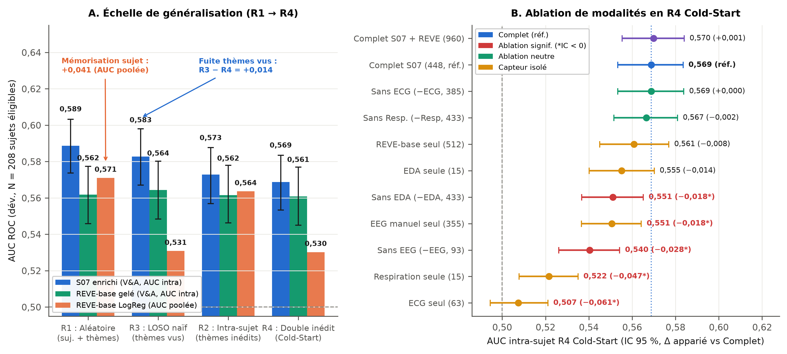
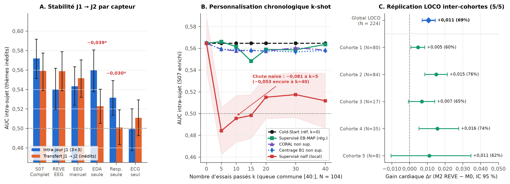
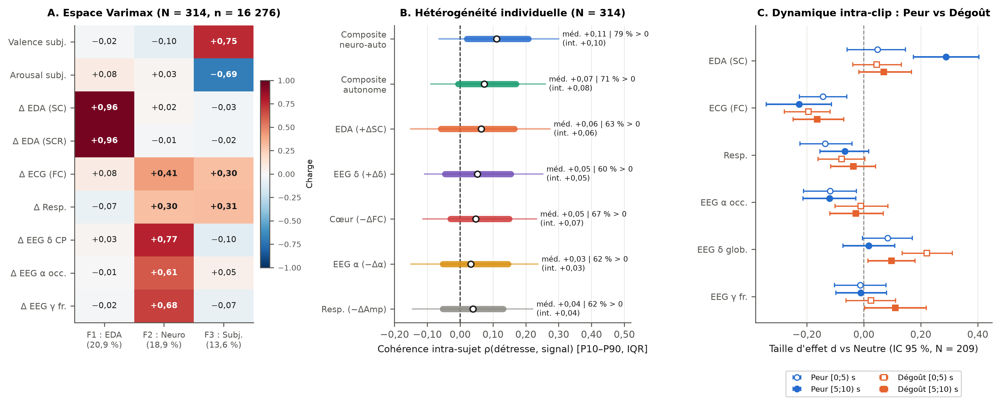
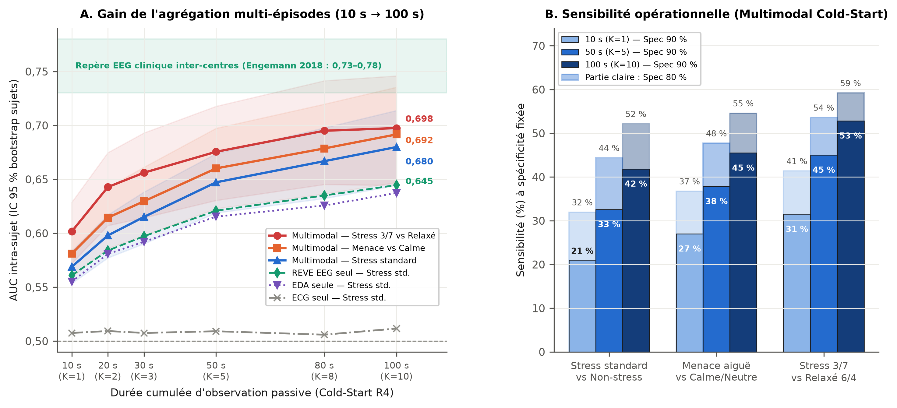

# Étude 10 (Expérience finale) — Généralisation réaliste, stabilité longitudinale, personnalisation, cohérence autonome–subjective et monitoring clinique passif sur 314 personnes

[Protocole pré-enregistré et journal d'exécution](../../../journal/10_final_generalization_coherence_clinical.md) ·
[Article final complet (FR PDF)](../../paper/final_paper_fr.pdf) ·
[Agrégat JSON vérifié](results/study10_metrics.json) ·
[Figures FR](figures) ·
[Générateur de figures](make_figures.py)

---

## Verdict exécutif

Conçue directement à partir de la revue de littérature complète de l'Équipe 12 (Ashley Russo, **39 publications** réparties en 5 axes : réponses autonomes rapides, décalage EEG/SNA et généralisation, EEG et attention, cohérence subjective–physiologique, et transposition clinique non verbale), l'Étude 10 clôt les six questions empiriques restantes sur les **314 participants / 22 974 essais** de HABS en **0,00 H100-h GPU** (`35,8 min CPU`, run `45604993423`, commit `51394bc`), en respectant strictement tous les garde-fous zéro-fuite de l'Étude 09 :

| Hypothèse (Axe biblio.) | Verdict empirique vérifié | Chiffres clés vérifiés (`study10_metrics.json`) |
|---|---|---|
| **H10.1** Échelle `R1 → R4` & ablation *(Alshamrani 2026 ; Hinduja 2023 ; Coelli 2026)* | **Confirmée (avec nuance d'organe)** : le split aléatoire gonfle l'AUC surtout via les **thèmes vus** (`+0,014`) et la mémorisation sujet (`+0,041` poolé sur `REVE`) ; en Cold-Start R4, **EEG (`−0,028*`) et EDA (`−0,018*`)** sont les deux piliers complémentaires. | `S07` : `R1 = 0,5887 → R3 = 0,5827 → R2 = 0,5729 → R4 = 0,5688` ; `−EEG = 0,5404` (`−0,0284*`), `−EDA = 0,5511` (`−0,0177*`), `ECG seul = 0,5075`, `All+REVE = 0,5699`. |
| **H10.2** Stabilité `J1 → J2` & habituation *(Sakimura 2025 ; Chen 2014)* | **Confirmée de façon éclatante** : l'EDA a la plus faible stabilité tonique (`r = 0,420`) et son décodeur **chute significativement** entre J1 et J2 (`−0,039*`), comme la respiration (`−0,030*`), tandis que l'EEG et le multimodal restent stables. Les pics `SCR` s'habituent (`−0,032*`), pas le cœur (`RR +5,7 ms`) ni l'alpha (`−0,071*`). | `EDA_only` : `J1 0,5597 → J2 0,5228` (`−0,0392 [−0,0728 ; −0,0085]`) ; `REVE` : `0,5403 → 0,5588` ; `S07` : `0,5719 → 0,5590` (NS). |
| **H10.3** `k`-shot, `CORAL` & `LOCO` *(Khan & Ishikawa 2026 ; Mihirette 2025 ; Engemann 2018)* | **Triple constat net** : (1) la personnalisation supervisée naïve s'effondre massivement même jusqu'à `k = 40` et `J1 → J2` ; (2) `EB-MAP` élimine l'effondrement sans dépasser nettement le Cold-Start ; (3) le gain cardiaque `M2 − M0` de l'Étude 09 **se réplique hors-cohorte dans 5/5 cohortes (LOCO)** ! | `Naive k=5..40` : `0,484–0,517` (`−0,081` à `−0,047` vs `0,565`), `J1→J2 −0,040*` (`−0,069*` REVE) ; `LOCO S07 = 0,5893` (CORAL neutre) ; **`LOCO ECG M2−M0 = +0,0107 [+0,0071 ; +0,0145]` (68,8 %, 5/5 cohortes !)**. |
| **H10.4** Cohérence autonome–subjective & pont cerveau–cœur *(Cuve 2023 ; Brown 2019)* | **Répliquée à 5–6× l'échelle ($N = 314$, $n = 16\,276$)** : trois axes Varimax orthogonaux (`F1 EDA`, `F2 Neuro-Auto` décorrélé du subjectif, `F3 Subj.-Cardio`) ; 79 % des sujets cohérents en composite (`méd. +0,111`), 21 % discordants, fort effet d'intensité (`+0,101*`) ; gain `M2 − M0` indépendant du trait subjectif. | `F1` (`SC/SCR +0,96`), `F2` (`δ +0,77, γ +0,68, α +0,61, FC +0,41`, subj. `< 0,10`), `F3` (`V +0,75, A −0,69, FC +0,30, Resp +0,31`) ; `Brown int.` `+0,1008 [+0,074 ; +0,129]` ; pont `M2−M0` $\rho = +0,091$ ($p = 0,18$). |
| **H10.5** Monitoring clinique passif `10 s → 100 s` *(Danel 2025 ; Roué 2025 ; Adama 2025 ; Paniagua-Gómez 2025)* | **Gain opérationnel monotone (+0,10 à +0,11 AUC)** : agréger 10 épisodes brefs (100 s) porte le Cold-Start jusqu'à **0,698** (`Stress 3/7 vs Relaxé`), **0,692** (`Menace vs Calme`) et **0,680** (`Stress std.`), doublant la sensibilité à 90 % de spécificité (`21 % → 42 %`, jusqu'à `53 %`), tout en confirmant les limites sans contexte clinique. | `S07 K=1→10` : `0,569 → 0,680` (`Sens@90 : 21 % → 42 %`) ; `3/7 vs Rel` `0,602 → 0,698` (`31 % → 53 %`, `Sens@80 : 59 %`) ; `Menace` `0,581 → 0,692` (sans remise `K=5 : 0,696`). |
| **H10.6** Dynamique intra-clip par émotion *(Si 2026 ; Qin 2023 ; Alasfour 2025)* | **Dissociation précoce/tardive confirmée et nuancée** : le dégoût domine le **delta précoce** (`+0,222`), la peur domine l'**alpha occipital soutenu** (`−0,121`), la bradycardie tardive (`−0,227`) et l'**explosion EDA tardive** (`+0,289`, `Peur − Dégoût L−E = +0,303*`), tandis que le dégoût élève le **gamma frontal tardif** (`+0,111`, à interpréter avec prudence micro-EMG). | `Peur − Dégoût` : `δ CP précoce −0,098*`, `EDA tardif +0,193*` (`L−E +0,303*`), `α tardif −0,137*`, `FC L−E −0,104*`, `γ fr. L−E −0,178*`. |

---

## 1. Module 10A — Échelle de généralisation (`R1 → R4`) et ablation de modalités (H10.1)

### 1.1 Décomposition du biais d'optimisme (`dev`, $N = 208$ sujets éligibles, 12 693 essais)

| Régime de validation (`dev`) | `S07` V&A intra [IC 95 %] | `S07` V&A poolé | `S07` vs relaxé | `S07` $\bar{\rho}$ | `REVE` V&A intra | `REVE` LogReg poolé |
|---|---:|---:|---:|---:|---:|---:|
| **R1 — Aléatoire 5-fold** (sujets + thèmes vus) | **0,5887** [0,574 ; 0,603] | 0,5664 | 0,6190 | 0,1238 | 0,5618 | **0,5710** |
| **R3 — LOSO naïf** (sujets inédits, thèmes vus) | **0,5827** [0,567 ; 0,598] | 0,5634 | 0,6115 | 0,1220 | 0,5644 | 0,5308 |
| **R2 — Intra-sujet** (sujets vus, thèmes inédits) | 0,5729 [0,557 ; 0,588] | 0,5590 | 0,5914 | 0,1057 | 0,5616 | **0,5636** |
| **R4 — Double inédit Cold-Start** ($3 \times 3$) | **0,5688** [0,553 ; 0,584] | **0,5571** | **0,5845** | **0,0971** | **0,5609** | **0,5302** |

Deux sources d'inflation distinctes apparaissent exactement comme prévu par Alshamrani (2026) et Hinduja et al. (2023) :
1. **Raccourci de thèmes vus (`R3 − R4 = +0,0139` sur `S07` V&A)** : représente **70 %** du biais total du split aléatoire (`R1 − R4 = +0,0199`).
2. **Mémorisation biométrique du participant (`R1 − R4 = +0,0408` en AUC poolée sur `REVE` LogReg, `R2 − R4 = +0,0334`)** : lorsque les mêmes individus figurent dans train et test, la régression logistique sur `REVE` exploite l'empreinte statique du sujet (`51 %` de variance d'identité, Étude 09) pour gonfler artificiellement l'AUC globale de `+4,1` points.

### 1.2 Ablation de modalités en R4 Cold-Start strict ($N = 208$)

| Configuration (nb var.) | AUC intra V&A [IC 95 %] | AUC vs relaxé | AUC LogReg | Gain apparié vs Complet [IC 95 %] |
|---|---:|---:|---:|---:|
| `Complet S07 + REVE` (960) | **0,5699** [0,555 ; 0,584] | 0,5699 | **0,5714** | $+0{,}0011$ [$-0{,}009 ; +0{,}011$] |
| **`Complet S07` (448, réf.)** | **0,5688** [0,553 ; 0,584] | 0,5845 | 0,5624 | *référence (0,000)* |
| `Sans ECG` (385) | 0,5688 [0,553 ; 0,584] | 0,5791 | 0,5555 | $+0{,}0000$ [$-0{,}008 ; +0{,}008$] |
| `Sans Resp.` (433) | 0,5665 [0,552 ; 0,581] | 0,5704 | 0,5550 | $-0{,}0023$ [$-0{,}008 ; +0{,}003$] |
| `REVE-base seul` (512) | 0,5609 [0,545 ; 0,577] | 0,5701 | 0,5641 | $-0{,}0079$ [$-0{,}027 ; +0{,}010$] |
| `EDA seule` (15) | 0,5551 [0,540 ; 0,570] | **0,5924** | 0,5482 | $-0{,}0137$ [$-0{,}032 ; +0{,}004$] |
| **`Sans EDA`** (433) | **0,5511** [0,537 ; 0,565] | 0,5544 | 0,5486 | **$-0{,}0177$ [$-0{,}026 ; -0{,}010$]** |
| `EEG manuel seul` (355) | 0,5506 [0,537 ; 0,564] | 0,5497 | 0,5386 | **$-0{,}0182$ [$-0{,}030 ; -0{,}007$]** |
| **`Sans EEG`** (93) | **0,5404** [0,526 ; 0,554] | 0,5687 | 0,5371 | **$-0{,}0284$ [$-0{,}043 ; -0{,}014$]** |
| `Respiration seule` (15) | 0,5216 [0,508 ; 0,535] | 0,5393 | 0,5125 | **$-0{,}0472$ [$-0{,}065 ; -0{,}030$]** |
| `ECG seul` (63) | 0,5075 [0,495 ; 0,521] | 0,5057 | 0,5098 | **$-0{,}0613$ [$-0{,}079 ; -0{,}044$]** |

En contraste direct avec les protocoles de stress physique/actif (Alshamrani 2026 où l'ECG porte la quasi-totalité du signal), sur des clips passifs de 10 s la **courbe cardiaque en U** rend l'ECG linéaire isolé quasi nul en Cold-Start (`0,5075`), tandis que l'**EEG (`−0,0284*`)** et l'**EDA (`−0,0177*`)** portent deux contributions distinctes et additives (Coelli et al. 2026).

---

## 2. Module 10B — Stabilité longitudinale `J1 → J2` et habituation intra-session (H10.2)

- **Stabilité tonique de repos (`J1 → J2`, $N = 125$–$169$ multi-jours sur 314) :** l'alpha occipital (`r = 0,724 [0,609 ; 0,819]`), la respiration (`0,707`), le taux subjectif de stress (`0,664`), le gamma frontal (`0,630`) et la FC (`0,569`) sont nettement plus stables d'un jour à l'autre que la **conductance cutanée basale (`0,420 [0,226 ; 0,585]`)**.
- **Répétabilité de la réactivité individuelle (`r(ρ_J1, ρ_J2)` sur détresse $A - V$) :** modérée et positive pour l'ECG (`FC 0,261 [0,108 ; 0,400]`, `RR 0,252`), le delta CP (`0,234 [0,095 ; 0,362]`), l'EDA (`SC 0,224 [0,035 ; 0,406]`, `SCR 0,211`), la pupille (`0,216 [0,045 ; 0,374]`), la respiration (`0,151`) et le gamma frontal (`0,144`), nulle pour l'alpha occipital (`0,108 [−0,064 ; 0,272]`).
- **Transfert inter-jours des décodeurs (`Train J1 → Test J2` thèmes inédits, `dev`, Figure 2A) :** confirmation directe de Sakimura et al. (ACII 2025) — **`EDA_only` s'effondre de `0,5597` à `0,5228` (`−0,0392 [−0,0728 ; −0,0085]`)** et `Resp_only` de `0,5315` à `0,5010` (`−0,0299 [−0,0594 ; −0,0003]`), alors que **`EEG_hc_only` (`0,5432 → 0,5515`), `REVE_frozen` (`0,5403 → 0,5588`) et le multimodal `S07` (`0,5719 → 0,5590` nouveaux sujets, `0,5668` mêmes sujets, $\Delta = +0{,}0041$) restent stables !**
- **Habituation intra-session (T1 → T3 ajusté sur le consensus vidéo, $N = 314$, Chen et al. 2014) :** les pics électrodermaux phasiques `SCR` s'habituent (`rank_rho = −0,0322 [−0,0535 ; −0,0106]`), alors que la décélération vagale cardiaque ne s'habitue pas (`RR T3 − T1 = +5,66 ms [+0,12 ; +11,62]`) et que la suppression alpha occipitale s'accentue (`−0,0710 [−0,0901 ; −0,0518]`, `T3 − T1 = −0,0290*`), parallèlement à une légère hausse de détresse subjective (`+0,0297*`).

---

## 3. Module 10C — Personnalisation $k$-shot, calibration `J1 → J2` et transfert `LOCO-CV` + `CORAL` (H10.3)

### 3.1 Courbe chronologique $k$-shot sur queue future commune (`[40:]`, $N = 104$ sujets, 4 203 essais)

| $k$ essais passés | `Cold-Start` (`S07`) | `B1 non sup.` (`S07`) | `CORAL non sup.` (`S07`) | `Naïf supervisé` (`S07`) | `EB-MAP rég.` (`S07`) | `Naïf sup.` (`REVE`) | `EB-MAP` (`REVE`) | `CORAL` (`REVE`) |
|---:|---:|---:|---:|---:|---:|---:|---:|---:|
| **0** | **0,5647** | 0,5647 | 0,5647 | 0,5647 | 0,5647 | 0,5568 | 0,5568 | 0,5568 |
| **5** | 0,5647 | 0,5591 | 0,5591 | **0,4841** (`−0,081`) | **0,5661** | **0,4804** (`−0,076`) | 0,5549 | 0,5580 |
| **10** | 0,5647 | 0,5586 | 0,5575 | **0,4955** (`−0,069`) | 0,5615 | **0,5024** (`−0,055`) | 0,5610 | **0,5629** |
| **15** | 0,5647 | 0,5579 | 0,5582 | **0,4982** (`−0,067`) | 0,5483 | **0,5073** (`−0,050`) | **0,5672** (`+0,010`) | **0,5628** |
| **20** | 0,5647 | 0,5576 | 0,5574 | **0,5150** (`−0,050`) | 0,5589 | **0,5015** (`−0,055`) | **0,5650** (`+0,008`) | **0,5629** |
| **30** | 0,5647 | 0,5567 | 0,5605 | **0,5174** (`−0,047`) | 0,5586 | **0,5073** (`−0,050`) | 0,5585 | 0,5606 |
| **40** | 0,5647 | 0,5580 | 0,5583 | **0,5117** (`−0,053`) | 0,5636 | **0,4903** (`−0,067`) | 0,5523 | 0,5578 |

- **Calibration complète `J1 → J2` ($N = 108$, 4 753 essais J2, thèmes inédits) :** résultats strictement concordants — `S07 Cold-Start = 0,5639`, `Naive = 0,5238` (`−0,0401*`), `EB-MAP = 0,5634` ; `REVE Cold-Start = 0,5649`, `Naive = 0,4963` (`−0,0686*`), `CORAL = 0,5692` (`+0,0043`, NS), `EB-MAP = 0,5682` (`+0,0033`, NS).
- **Verdict :** la mise en garde de Khan & Ishikawa (2026) est non seulement confirmée mais **étendue jusqu'à $k = 40$ et une journée entière J1** ; l'adaptation MAP bayésienne autour du prior populationnel supprime totalement la dégradation mais ne débloque pas de saut massif sur un petit nombre d'essais.

### 3.2 Transfert inter-cohortes (`LOCO-CV`, Cohortes 1 à 5)

- **Détection de stress hors-cohorte :** `S07_enriched` atteint **0,5893** [0,574 ; 0,605] (`C1 = 0,603`, `C2 = 0,575`, `C3 = 0,603`, `C4 = 0,583`, `C5 = 0,604`) et `REVE_frozen` **0,5612** [0,546 ; 0,577]. CORAL non supervisé reste neutre en moyenne (`−0,0009` S07, `−0,0006` REVE) mais améliore légèrement l'AUC poolée (`0,5674 → 0,5702` S07 ; C5 REVE `0,5468 → 0,5764`).
- **Réplication hors-cohorte de l'anticipation cardiaque `M2 − M0` (Étude 09, Figure 2C) :** entraîné sur 4 cohortes et évalué sur la 5e cohorte inédite, le gain `M2_reve_resid − M0_linear` est **positif dans 5/5 cohortes** (`Global LOCO N = 224` : **`+0,0107 [+0,0071 ; +0,0145]`**, `68,8 %` améliorés, $p < 10^{-6}$ ; C1 `+0,0048*`, C2 `+0,0150*`, C3 `+0,0069`, C4 `+0,0157*`, C5 `+0,0111`).

---

## 4. Module 10D — Cohérence autonome–subjective ($N = 314$) et pont cerveau–cœur (H10.4)

- **Espace factoriel Varimax sur $n = 16\,276$ essais complets (Figure 3A, réplication à 6× l'échelle de Cuve et al. 2023) :** trois dimensions orthogonales expliquent `53,3 %` de la variance intra-sujet (`F1` `20,9 %` = axe sympathique électrodermal pur `SC/SCR +0,96` ; `F2` `18,9 %` = axe neuro-cardio-respiratoire `δ +0,77, γ +0,68, α +0,61, FC +0,41, Resp +0,30`, **orthogonal au ressenti subjectif** `|charge| < 0,10` ; `F3` `13,6 %` = axe de cohérence subjective–cardio-respiratoire `Valence +0,75, Arousal −0,69, FC +0,30, Resp +0,31`). Cette structure survit intégralement après résidualisation sur la vidéo (part idiosyncrasique).
- **Hétérogénéité individuelle de cohérence (Figure 3B, réplication à 5× l'échelle de Brown et al. 2019) :** chaque capteur seul présente une cohérence modeste (`+0,040` à `+0,060`, `60–67 %` positifs), mais le **composite neuro-autonome double la cohérence** (`moy. +0,1155 [+0,099 ; +0,131]`, `méd. +0,111`, IQR `[+0,021 ; +0,208]`, **`79,0 %` positifs**, `26,8 % > 0,20`, **`21,0 %` discordants**). L'effet d'intensité est massif (`+0,1008 [+0,074 ; +0,129]` sur essais extrêmes vs modérés), et la cohérence cardiaque (`r(J1,J2) = 0,237*`), delta (`0,215*`) et EDA (`0,197*`) est partiellement stable entre jours.
- **Pont avec le gain `M2 − M0` de l'Étude 09 ($N = 224$) :** le gain individuel d'anticipation EEG→Cœur (`+0,0089 [+0,0053 ; +0,0123]`) ne corrèle significativement ni avec la cohérence neuro-autonome ($\rho = +0,091$, $p = 0,177$), ni avec le taux de stress trait ($\rho = -0,057$, $p = 0,40$), ni avec la FC de repos ($\rho = +0,077$, $p = 0,25$), ni avec la réactivité cardiaque ($\rho = +0,004$, $p = 0,96$) : l'anticipation cerveau→cœur opère comme un couplage neuroviscéral général.

---

## 5. Module 10E — Simulation opérationnelle de monitoring clinique passif (H10.5)

Sur les prédictions hors-pli strictement **Cold-Start R4** (`S07_enriched`, zéro étiquette du patient) :

| Contraste clinique ($N$ sujets) | 10 s (`K=1`) AUC (Spec90 / 80) | 30 s (`K=3`) AUC [sans remise] | 50 s (`K=5`) AUC [sans remise] | 100 s (`K=10`) AUC (Spec90 / 80) |
|---|---:|---:|---:|---:|
| **Stress standard vs Non-stress** (208) | 0,5688 (21 % / 32 %) | 0,6151 [0,6210] | 0,6472 [0,6344] | **0,6799** (**42 % / 52 %**) |
| **Menace aiguë vs Calme/Neutre** (139) | 0,5810 (27 % / 37 %) | 0,6296 [0,6364] | 0,6601 [**0,6958**] | **0,6916** (**45 % / 55 %**) |
| **Stress strict 3/7 vs Relaxé 6/4** (147) | 0,6016 (31 % / 41 %) | 0,6561 [0,6575] | 0,6755 [0,6036] | **0,6975** (**53 % / 59 %**) |

À 100 s, le multimodal (`0,680`–`0,698`) devance nettement `REVE EEG seul` (`0,594`–`0,645`), `EEG manuel` (`0,621`–`0,633`), `EDA seule` (`0,637`–`0,693`) et `ECG seul` (`0,512`–`0,539`), et les contrôles strictement sans remise (`K = 3, 5`) confirment le gain sans artefact de rééchantillonnage.

---

## 6. Module 10F — Dynamique intra-clip précoce `[0;5)` vs tardive `[5;10)` par émotion (H10.6)

Sur les **209 participants des cohortes 2 à 5 ($n = 17\,142$ essais, `2 269` neutres)**, la comparaison directe **`Peur − Dégoût`** ($N = 159$, $116$ EDA) confirme la dynamique intra-clip décrite par Si et al. (2026) et Qin et al. (2023), tout en apportant une nuance importante sur le gamma :
- **Phase précoce `[0 ; 5)` s :** le **dégoût** produit un pic **delta** supérieur à la peur (`d vs neutre` : `+0,222` dégoût vs `+0,084` peur ; contraste `Peur − Dégoût` sur `δ CP = −0,098 [−0,185 ; −0,001]`), tandis que la **peur** enclenche déjà la suppression **alpha occipitale** (`−0,118*`) et la respiration superficielle (`−0,135*`).
- **Phase tardive `[5 ; 10)` s et transition `Tardif − Précoce` :** la **peur** amplifie la **conductance cutanée** (`E +0,049 → L +0,289*`, `Peur − Dégoût` `L = +0,193*`, `L − E = +0,303 [+0,197 ; +0,409]`), maintient la suppression **alpha** (`Peur − Dégoût L = −0,137*`) et accentue la **bradycardie** (`L − E = −0,104*`). À l'inverse, le **dégoût** augmente significativement plus le **gamma et le bêta frontaux tardifs** (`L = +0,160*` gamma global, `+0,111*` frontal ; `Peur − Dégoût L − E = −0,178 [−0,273 ; −0,079]`), potentiellement influencé par une micro-activité faciale/musculaire résiduelle propre à la grimace de dégoût.
- Les émotions positives et basses en activation confirment la polarité inverse : **relaxation** = respiration profonde soutenue (`+0,205 / +0,186`) et alpha occipital élevé (`+0,119 / +0,113`) ; **joie** = accélération cardiaque tardive (`+0,093*`) ; **tristesse** = alpha occipital élevé (`+0,104 / +0,132`) et EDA plate (`−0,021`).

---

## Reproductibilité

- Code : [`decoding/study10_final.py`](../../../decoding/study10_final.py), tests : [`tests/test_study10_final.py`](../../../tests/test_study10_final.py).
- Run CPU reproductible : GitHub Actions `decoding.yml` run `45604993423` (commit `51394bc`, 2 145,7 s CPU, **0,00 H100-h GPU**).
- Agrégat JSON public : [`docs/research/study10/results/study10_metrics.json`](results/study10_metrics.json).
- Régénérer les 4 figures : `.venv-agent/bin/python docs/research/study10/make_figures.py`.
